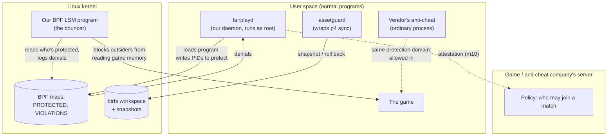

# fairplay-os, explained

A plain-English tour of what's in this repo, how the pieces fit, and what every
acronym means. The [README](../README.md) has the commands; this file has the
"why"; the [design doc](design.md) is the plan everything follows. Terms in
**bold** are in the [glossary](#glossary) at the bottom.

## The one-paragraph version

We're prototyping a Linux-based operating system to replace Windows, both on
gamers' PCs and on game developers' workstations. The headline for players:
competitive games without **kernel-level anti-cheat**, which gamers dislike
because it runs a vendor's code with full control of the machine. It has three
jobs. **A:** keep huge game-asset checkouts from getting half-broken when a
download dies midway. **B:** let the operating system itself protect a running
game from cheat tools, and later prove to a game server that it did, so
anti-cheat companies don't need to install their own code into the kernel.
**C:** keep the game smooth while other programs (downloads, browsers,
compiles) run. Everything is developed in a Linux virtual machine on a Mac;
the parts that need a real gaming PC come later.

## Where things stand

| # | Milestone | State | How to see it work |
| --- | --- | --- | --- |
| 1 | VM baseline | Done | `./vm/check-milestone1.sh`, then `lsm-hello` (README) |
| 2 | assetguard vs a real Perforce server | Done | `./vm/test-milestone2.sh` |
| 3 | Protected process | Done | `cheatsim` + `fairplayd` (README) |
| 4 | fairplayd socket API | Done | `./vm/test-milestone4.sh` |
| 5 | Protection follows the game's child processes | Done | `./vm/test-milestone5.sh` |
| 6 | fairplayd protects itself from root | Done (opt-in: `--self-protect`) | `./vm/test-milestone6.sh` |
| 7 | Report fake input devices and who made them | Done | `./vm/test-milestone7.sh` |
| 8 | Only approved code may load into the game | Done | `./vm/test-milestone8.sh` |
| 9 | Vendor anti-cheat: signed and sandboxed | Done | `./vm/test-milestone9.sh`, `./vm/test-milestone9b.sh` |
| 10 | Attestation | Blocked: the VM has no TPM | |
| 11 | Player-mode system image | Needs an x86 PC | |
| 12 | A Windows game under **Proton**, protected | Needs an x86 PC | |

The [design doc](design.md#milestones) has each one's exit test.

## Player mode and developer mode

On a gamer's PC the owner has full admin rights (**root**), and the owner
might be the cheater. On a developer's PC the owner needs debuggers and
unsigned code. So the OS boots in one of two **modes**:

- **Player mode** (the default): the system files are signed and read-only,
  kernel **lockdown** is on, and root can still install apps and change
  settings but can't switch off the game protection. Turning it off takes a
  reboot, and the game's server can tell.
- **Developer mode** (picked at boot): everything is open. Games still run;
  the server just knows the machine is in developer mode and decides what to
  allow, such as casual matches only.

A game can never switch modes itself. It can only ask the OS to show "Ranked
needs player mode. Restart now?", and the user decides. Discord, Spotify, a
browser and OBS keep running alongside the game in either mode; they just can't
read or tamper with it.

## The big picture

The rule that shapes everything in Part B: **the kernel enforces, user space
decides, the server sets policy.** Our kernel program is a dumb bouncer that
checks a list. `fairplayd` decides what goes on the list. The game company's
server decides whether a machine with a given setup may join ranked play. No
anti-cheat company ships kernel code.

## Part A: the file layer

**The problem.** Game studios keep code and art in **Perforce**, often hundreds
of GB per checkout. If a `p4 sync` (the download) is killed halfway, by a crash,
a full disk or a dropped network, you're left with a mix of old and new files
and some files cut off partway through. The game editor then crashes or, worse,
silently saves corrupted assets.

**What we built.**

- **`safewrite`** (a library, done). A safe way for our own tools to write a
  file: write to a temporary file next to it, **fsync** it to disk, then
  **rename** it over the original. A rename is all-or-nothing, so after a crash
  you have either the whole old file or the whole new one, never half of each.
- **`assetguard`** (a command-line tool). Wraps `p4 sync` in four steps:
  1. **Snapshot** the workspace. It lives on **btrfs**, which can freeze an
     instant, read-only copy of a whole directory tree without copying any data.
  2. **Sync** as normal.
  3. **Verify**: ask the server for the **MD5** fingerprint and size of every
     file, then check what's actually on disk. A cut-off file fails this. Bad
     files get one re-download attempt.
  4. **Case-check**: flag names that differ only in capitals (`Hero.png` vs
     `hero.png`). Linux treats those as two files, but Windows and Mac don't, so
     they break teammates on those systems.

  If any step fails, it **rolls back**: the broken workspace is moved aside
  (kept as `ws.failed-<time>` so you can look at it), the snapshot is put back
  in its place, and the Perforce server's record of what you have (the **have
  list**) is reset to match.

**Why the have list matters.** Perforce doesn't look at your disk to decide
what to download; it trusts its own record of what you have. If we restored
the files but not that record, the server would think you already had the new
versions. `p4 sync` would then say "up to date" and leave you on old files,
and worse, `p4 reconcile` would see your old files as *your edits*, so a
submit would quietly revert teammates' work. So before every sync, assetguard
saves the have list next to the snapshot (`pre-sync-<time>.have`), and
rollback puts it back exactly with `p4 flush`.

**Milestone 2's test** (`vm/test-milestone2.sh`) starts a throwaway Perforce
server, makes a depot with two versions of some files, and syncs a fresh btrfs
workspace to version 1. Then it tries four ways to break a sync to version 2:

| Scenario | What happens | Expected |
| --- | --- | --- |
| p4 killed mid-sync | One file updates, the next is cut off, p4 dies | Roll back |
| File keeps arriving truncated | The re-download is cut off too | Roll back |
| File arrives truncated once | The re-download works | Sync succeeds |
| Depot gains `Hero.uasset` next to `hero.uasset` | Case collision | Roll back |

The faults come from a stand-in `p4` that assetguard uses instead of the real
one (via the `ASSETGUARD_P4` variable). After each scenario the test asks
**Perforce itself**, not assetguard, whether the client is consistent: the
have list must match the expected version exactly, and `p4 reconcile -n` must
find no file on disk that differs from it.

**Limits of v0.** If the machine dies *during* a rollback (between moving the
workspace aside and restoring the snapshot), you'll find `ws` missing and
`ws.failed-*` plus the snapshot present, and need to finish the job by hand.
Old snapshots and failed workspaces aren't cleaned up automatically yet.
Rollback swaps the whole workspace, so close the editor (and `cd` out of the
workspace) first.

## Part B: fairness primitives

**The problem.** Cheats work by reading or changing a game's memory from
another program, for example to find where enemies are. Anti-cheat companies
fight this today by installing their own kernel drivers. These are powerful,
invasive, and a crash or security hole in one takes down the whole machine.

**Our approach.** Use a hook the Linux kernel already has. **LSM** hooks are
checkpoints the kernel passes through before sensitive actions, and with
**BPF LSM** we can attach a small, safety-checked program to one. Ours sits on
`ptrace_access_check`, the single checkpoint for *every* way one process can
read another's memory:

| Attack path | What it is |
| --- | --- |
| **ptrace** attach + peek | The debugger interface (what `gdb` uses) |
| `process_vm_readv` | A system call that copies memory out of another process |
| `/proc/<pid>/mem` | A file that *is* another process's memory |

**The pieces.**

- **`fairplay-ebpf`**: the bouncer, running inside the kernel. On every memory
  access it asks: is the target in the `PROTECTED` list? Is the caller the same
  process, or in the same *protection domain* (the game's own anti-cheat)? If
  not, it says no (**EPERM**) and writes a record to `VIOLATIONS`.
- **`fairplay-common`**: the shared shape of those records, so the kernel side
  and the user side agree byte for byte.
- **`fairplayd`**: the **daemon**. It loads the bouncer, writes PIDs into the
  list, prints a `DENIED` line for each record, and answers games and
  anti-cheat programs over a socket (milestone 4, below). Protection ends
  when it exits, so a crashed `fairplayd` fails open, not closed.
- **`fairplayctl`** (in `crates/fairplay-api`): a small command-line client
  for that socket, for people and tests.
- **`cheatsim`**: the test cheat. `cheatsim game` holds a secret number in
  memory; `cheatsim attack` tries all three paths to read it. It runs as
  **root** on purpose: normally root may read anything, so a block proves it
  was our program that did it.
- **`lsm-hello`**: milestone 1's smoke test. It logs every file `cat` opens,
  which proves the whole BPF LSM toolchain works end to end.
- **`fairplay-attest`**: milestone 10, outline only. The plan: the **TPM** chip
  records what booted (**measured boot**) and **IMA** records which programs
  ran. On request, the TPM signs those records (a **quote**) and the game
  company's server checks them: was it a known kernel, was `fairplayd` running,
  was our bouncer loaded? The OS only reports facts; the server decides.

### The socket API (milestone 4)

Programs talk to `fairplayd` through a **Unix domain socket**,
`/run/fairplayd.sock`: a file-like address that only programs on the same
machine can connect to. Each request and each answer is one line of
**JSON**. The calls follow the design doc's "vendor-facing API":

- **`launch_protected`**: "start this game, protected". Only a *launcher*
  may ask: root, or a member of the `fairplay-launcher` group. `fairplayd`
  starts the program itself, so there's no moment where the game runs
  unprotected: it **forks** a child, the child waits on a pipe, `fairplayd`
  puts the child's PID in the `PROTECTED` list, and only then lets the child
  switch to the launcher's user and start the game. The game never runs as
  root unless root explicitly asks for that. (Since milestone 9, only a
  program a signed game manifest names; see below.) Variables like `LD_PRELOAD`,
  which tell Linux to load extra code into a program, are dropped (the
  design doc's "clean launch environment"), and the game gets
  **no_new_privs**, so it can't gain privileges later. With `join`, the
  launcher starts a second program *inside* the game's session: that's how
  the vendor's anti-cheat gets permission to inspect the game (since
  milestone 9, only the anti-cheat the manifest names, as a *reader*).
- **`session_status`**: is it protected? Plus the game's state (running, or
  its exit code), who's in its domain, how many attempts were blocked, the
  kernel's **lockdown** mode, and the virtual input devices (fake keyboards
  and mice, the kind aimbots make) that exist, with who made each (milestone
  7). Called without a session,
  it answers about the caller's own session, which is what an anti-cheat
  sitting next to the game wants.
- **`violations`**: a live **stream**. The caller subscribes once, and every
  denied attempt is pushed to it as it happens: which process, which
  executable, which hook. Vendors get detection signal without a driver.
- **`attest`**: will return the TPM's signed report (milestone 10). The VM has
  no TPM, so for now it answers `unavailable`, honestly, and echoes the
  nonce it was given.

**How it knows who's calling.** The kernel tells it. When a program
connects, `fairplayd` asks the kernel for the caller's process ID, user and
groups (**SO_PEERCRED**, **SO_PEERGROUPS**); nothing in a request can claim
to be someone else. Each user sees only their own sessions; root sees all.
The game's own anti-cheat (a process in the session) may see its session too.

**Cleaning up.** When a protected program exits, `fairplayd` removes its PID
from the list *before* **reaping** it. Until it's reaped, the exited process
is a **zombie** whose PID the kernel won't hand out again, so a new, unrelated
process can never inherit the protection. (Since milestone 5 the kernel also
does this itself, for every process in a domain; see below.)

**Milestone 4's test** (`vm/test-milestone4.sh`) plays every part: a launcher
starts `cheatsim game`, a mock anti-cheat (a short Python script that speaks
the JSON directly) joins its domain and subscribes to violations, and
`cheatsim attack` runs as root. The attack must leak nothing, and the mock
vendor must receive exactly three events, one per attempt, each naming the
process, its executable and the hook.

"Which executable" is read inside the kernel, like the process name, because
the attacker is often gone by the time `fairplayd` could look it up. The BPF
program follows `task->mm->exe_file` to the file's name. Those structs are
among the ones whose layout moves between kernels, so `fairplay-ebpf/build.rs`
finds each field in `vmlinux.rs` at build time, the same trick as
`lsm-hello-ebpf`. The full path is added from user space when the caller is
still running.

**"Best-effort"** is deliberate. Someone with physical access and a custom
kernel can defeat any of this. The point is that attestation then *shows* a
different kernel, and the server can act on that.

### The domain follows the game (milestone 5)

A Windows game under **Proton** isn't one process. Steam starts `proton`,
which starts `wine`, which starts `game.exe`, with `wineserver` running
alongside. `fairplayd` launches only the first, so every process the game
starts has to join its protection domain on its own, the instant it exists.
A cheat that could read the game's grandchild would read the game.

The kernel does this, with two more small BPF programs (in
`fairplay-ebpf/src/follow.rs`). They aren't checkpoints that can say no;
they're **tracepoints**, which only watch:

- **When a process forks**, if the parent is in `PROTECTED`, the new child
  goes in with the parent's domain. This happens inside the parent's `fork`
  call, before the child has run anything. (For the split second when the
  child exists but isn't listed yet, the bouncer treats a child of a
  protected process as protected.) New *threads* don't need an entry: the
  process they belong to has one.
- **When the last thread of a protected process exits**, its entry goes,
  while the process is still a zombie. As with the game itself, the PID
  can't be reused until the entry is gone, so a cheat started at just the
  right moment can't inherit a place in the game's domain.

`fairplayd` still removes the game it launched itself; the kernel has
usually done it already, and removing twice is harmless.

**When the list is full.** `PROTECTED` holds 1024 processes. If a new child
doesn't fit, it runs unprotected. Rather than let that happen silently, the
kernel counts it per domain (the `UNFOLLOWED` map) and `session_status`
reports **`protection_degraded`**, with how many. What a game server does
about that is its own policy.

The launch environment now also drops `WINEDLLOVERRIDES` and `WINEDLLPATH`,
which would let a cheat's DLL load inside a Proton game, the way
`LD_PRELOAD` does for Linux programs. Children inherit the clean environment.

**Milestone 5's test** (`vm/test-milestone5.sh`) launches `cheatsim game
--depth 2`: the game forks a child, the child forks a grandchild, and the
grandchild holds the secret. A root attack on the grandchild must leak
nothing and print three `DENIED` lines. It also checks that the grandchild
is in `PROTECTED` with the game's domain, that the Wine and `LD_` variables
never reached it, that its entry is gone while it's still a zombie, that the
same game started without `fairplayd` leaks 3/3, and that a full `PROTECTED`
shows up as `protection_degraded`.

### fairplayd protects itself (milestone 6)

Everything above is enforced by `fairplayd`'s programs and maps. If root
could kill `fairplayd`, delete the game from `PROTECTED`, or unhook the
checkpoints, the protection would be one command away. In player mode root
might be the cheater, so `fairplayd --self-protect` turns on four more
checkpoints that guard `fairplayd` itself, from every other process, root
included:

| Checkpoint | What it stops |
| --- | --- |
| `task_kill` | sending `fairplayd` any **signal**, even `kill -9` (SIGKILL) and SIGSTOP |
| `ptrace_access_check` | tracing it, reading its memory, or copying its open files (`pidfd_getfd`) |
| `bpf_map`, `bpf_prog` | opening its maps or programs, which is the first step of reading or changing them (`bpftool map dump`) |
| `bpf` | loading any new BPF program, and detaching attached ones |

Why refuse *every* new BPF program? Because a BPF program loaded by root can
read the memory of whatever process it happens to run in, and the
`ptrace_access_check` checkpoint never sees that. The cost is that nothing
else can load BPF programs while it's on (systemd uses a few for firewall
and device rules), so player mode will have to load those first.

It's **off unless asked for**: developer mode keeps normal root, and so does
the shared test VM. Nothing over the socket turns it off. For tests,
`--self-protect-for 30` turns it off after 30 seconds and exits.

What it doesn't stop, on purpose (other layers cover these): root changing
the kernel itself (lockdown's job), rebooting into something else
(attestation's job), reading the swap disk (encrypted swap), and a handful
of ways root can make the *kernel* stop `fairplayd` for it, such as killing
its whole **cgroup** or provoking the out-of-memory killer. Those don't pass
through `task_kill`; the README lists them with their fixes.

**Milestone 6's test** (`vm/test-milestone6.sh`) shows root killing an
unprotected `fairplayd`, then, against one started with
`--self-protect-for 60`, tries as root: `kill -9`, `kill -STOP`,
`kill -TERM`, `bpftool` dumping and changing its maps (including the switch
that turns self-protection off) and detaching a program, and `cheatsim
self-attack` (ptrace, memory reads, stealing a file descriptor, loading a
BPF program, detaching). Every attempt fails with one `DENIED` line; then
`fairplayd` switches itself off on time and leaves nothing loaded.

### Only approved code loads into the game (milestone 8)

Reading the game's memory is blocked, but a cheat could still get its code
*into* the game: drop a library file somewhere and trick the game into
loading it (a plugin folder, a config file that names a path), or, since
milestone 5, get the game to start a dropped program, which would then be
inside the game's domain. Clearing `LD_PRELOAD` at launch doesn't catch
those.

Every way of loading code from a file ends the same way: the kernel
**maps** the file into memory with permission to run it (**PROT_EXEC**).
`dlopen` does that, the loader does it for every library, `execve` does it
for a new program, and Wine does it for DLLs. So two more checkpoints watch
exactly that, for protected processes only: `mmap_file` (map a file as
code) and `file_mprotect` (map it as data, then switch it to code). The
file must be one of:

- a **system file**: on the system disk, owned by root, writable by nobody
  else. The loader, libc and graphics drivers are covered without a list;
- one that was in the game's **install directory** at launch. `fairplayd`
  walks that directory and lists every program and library file in it;
- an **approved overlay** (Steam, Discord, MangoHud), named with
  `fairplayd --overlay`.

The list holds **inodes**, not file names. A file dropped after launch, or a
library swapped for a different one at the same path, is a new inode, so it
isn't on the list. Code a game generates in memory (a **JIT**, as Wine, .NET
and shader compilers use) isn't a file and isn't checked: putting code there
from outside would need a write into the game's memory, which milestone 3
already blocks.

What a blocked load looks like: `dlopen` fails ("failed to map segment"),
`mprotect` fails with `EPERM`, and a blocked program start kills the new
process (the kernel has already given up the old program by the time it
maps the new one). Each shows up as a `DENIED` line and in the violation
stream with the file's name.

**Known weakness.** If the game's own files are writable by the player (they
usually are), a cheat can rewrite an allowed file in place: same inode, new
content. Checking content hashes (IMA or fs-verity) would close that; it's a
design question for later.

**Milestone 8's test** (`vm/test-milestone8.sh`) asks a protected `cheatsim`
to load a dropped library (blocked), one from its install directory (loads),
one swapped after launch (blocked) and an approved overlay (loads), to make
a dropped file executable with `mprotect` (blocked), and to start
`/usr/bin/true` (works) and a dropped copy of it (killed). The same dropped
library loads fine in an unprotected game.

### Fake input is reported, with who made it (milestone 7)

An aimbot or triggerbot doesn't need to touch the game's memory to cheat: it
can click for you. On Linux a program fakes input in three ways:

- **uinput**: create a fake keyboard or mouse (one **ioctl** call,
  `UI_DEV_CREATE`, on `/dev/uinput`);
- **uhid**: create a fake USB-style device (**HID**) by writing to
  `/dev/uhid`;
- write events straight into a real device's **evdev** node,
  `/dev/input/eventN`.

Blocking these would break Steam Input (which remaps controllers through
uinput) and the accessibility tools disabled players rely on. So by default
the OS **reports** instead of blocking. Three more checkpoints
(`file_ioctl`, `file_ioctl_compat`, `file_permission`) record each one with
the process and program that did it. They're cheap for everything else:
an unrelated ioctl costs one comparison, and an unrelated write a look at
which device the file is.

- During a protected session, each one prints a `REPORTED` line and goes to
  the vendor's violation stream marked `"outcome":"reported"`, so a vendor
  can tell a report from a block.
- Tools the machine's owner trusts are on an **allowlist**
  (`fairplayd --input-allow <program>`, matched by inode). They're never
  reported.
- `session_status` lists every fake input device, which program made it,
  and whether that program is allowlisted.
- A game whose server wants more can launch with `block_virtual_input`:
  while it runs, fake input from programs not on the allowlist is refused
  (**EPERM**) and shows up as `DENIED`. Blocking stops input from
  non-allowlisted virtual devices, **including ones created before the
  match**: a clicker started earlier goes silent, then works again when
  the game exits. Players should know this covers the **whole computer**,
  not just the game, because input devices aren't per-program: until that
  game exits, only allowlisted tools can make or use fake devices.
- With no protected game running, nothing is reported.

**Milestone 7's test** (`vm/test-milestone7.sh`) starts a protected game,
then `cheatsim clicker` as root (listed as made by `cheatsim`, reported), an
allowlisted copy of it (listed as allowlisted, not reported), an evdev
write and a uhid device (reported), then a second game that asks for
blocking: the cheats get `EPERM`, including a clicker started before the
match, while the allowlisted tool keeps working.

### Signed manifests and readers (milestone 9, part A)

Up to milestone 8, every process in a game's protection domain could read
every other one, and the launcher chose what to start. On a player's PC the
launcher is the player. So a player could launch a tiny Python **wrapper**
that starts the real game as its child: the wrapper was in the domain, so it
could read the game freely. Milestone 8 didn't help, since Python is a
normal system program and a script isn't code the kernel maps.

Two changes close that:

- **Members vs readers.** The game and everything it starts are still
  *protected members*: nobody outside can read them. But members can no
  longer read each other either, not parent, child or sibling. Only
  **readers** may: the vendor's anti-cheat, and helpers the game's manifest
  names (Proton's `wineserver`, which does Windows' "read another process"
  calls for the game). The kernel decides who is a reader at the moment a
  process starts a program (**exec**): if the file it starts is one of the
  manifest's reader files (matched by inode, as in milestone 8), it becomes
  a reader; if it starts anything else, it stops being one. Being *started
  by* a reader doesn't make you one.
- **The game manifest.** Each game ships a small JSON file, signed by its
  publisher or anti-cheat vendor with an **ed25519** key, that lists what
  may be launched (by **SHA-256** hash), which programs are readers, and
  which Proton files and overlays are accepted. The signature is a
  **detached signature**: a separate `game.json.sig` file. `fairplayd`
  launches only what the manifest names, and only if the file's hash
  matches. It hashes the file through the same open handle it then starts
  (**fexecve**), so the file can't be swapped in between.

**The OS doesn't pick publishers.** `fairplayd` checks that the manifest is
signed by the key written inside it, and that's all. Anyone can sign a
manifest, including a cheater. But `session_status` reports the signer's
**fingerprint**, and the game's server only lets players into ranked play
if its own vendor's key signed the manifest. So the OS stays neutral and the
decision stays with the server, as the design doc wants.

**Known weakness.** If the player can write to the game's files, they can
still rewrite one *in place* after `fairplayd` checked it. **fs-verity**,
where the kernel itself checks every page of a file against a sealed hash,
is the later fix (for milestone 8's allowlist too).

**Milestone 9's test** (`vm/test-milestone9.sh`) launches the wrapper attack
from a cheater-signed manifest (blocked, and `session_status` shows the
cheater's key), has the game's child try to read its parent and a sibling
(blocked), joins a signed mock anti-cheat (it can read the game), has the
game start a named helper (can read) and the same program copied to an
unnamed path (can't), and checks that unnamed programs can't join and that a
tampered manifest, a wrong signature and a changed program are all refused
with nothing started.

### The anti-cheat sees the game and nothing else (milestone 9, part B)

The design doc promises something no kernel anti-cheat can: the vendor's
anti-cheat sees the game, and nothing else of your PC. Two walls make that
true, and a few smaller rules close the gaps around them.

- **Memory.** The kernel checkpoint that guards reading another process's
  memory now also works the other way round: the anti-cheat (and the game,
  and anything they start) may only reach processes of its own game. Your
  browser, Discord or password manager are off limits, even though they run
  as the same user. Every attempt is refused and reported in the session.
- **Files.** `fairplayd` starts the anti-cheat in its own **mount
  namespace**: a private view of the file system. It builds a fresh, empty
  root, puts in only what's needed using **bind mounts** (system libraries
  read-only, a few settings files, the game's folder and the anti-cheat's
  own folder read-only, one writable data folder for the vendor, the
  `fairplayd` socket, a private `/tmp`), and then switches the anti-cheat
  into it with **pivot_root**. Your home folder simply isn't there. The
  network is, because the vendor talks to its server.

The kernel has to know which processes those rules are for. That's the
**`SANDBOXED`** list (a BPF map): `fairplayd` adds the anti-cheat to it
before it runs a single instruction of its own, everything the anti-cheat
starts is added automatically, and each entry goes when its process exits.
On top of the two walls, everything on that list gets four more rules:

- **It may look, not touch.** The anti-cheat needs to *read* the game's
  memory and its list of loaded modules, never change them. A **seccomp**
  filter (secure computing mode: a list of **system calls** the kernel
  refuses for that process and everything it starts) blocks the ways to
  write to, debug or steer the game: `ptrace`, `process_vm_writev`,
  `pidfd_getfd` and `process_madvise`. The one way seccomp can't see,
  opening the game's `/proc/<pid>/mem` file for writing, is refused by the
  kernel's `file_open` checkpoint. Signals (stop, continue, kill) to
  anything outside the sandbox, the game included, are refused too: what
  happens to a cheater's game is the server's decision.
- **Defence in depth.** The same filter also refuses system calls that
  nothing reading a game needs, but that could be used to reshape the
  sandbox from inside: making new **namespaces** (`unshare`, `setns`, and
  `clone` asking for one), attaching, detaching or changing **mounts**
  (`mount`, `umount2`, `pivot_root`, `chroot` and the newer `open_tree`
  family), the kernel **keyring** (`keyctl`, `add_key`, `request_key`) and
  `bpf`. Most of these already need privileges the anti-cheat normally
  lacks, so the filter is a second lock on the same door. The exception is
  a new *user* namespace, which many distributions let any user create:
  inside it they count as root and may mount things of their own. One
  wrinkle: `clone3`, the newer way to start a thread or process,
  keeps its settings where seccomp can't read them, so it's answered with
  **ENOSYS** ("not implemented"). The standard C library (glibc) then quietly
  uses the older `clone`, which seccomp *can* check.
- **No back doors through `/proc`.** Linux's `/proc` folder has a
  subfolder per process, with special shortcuts (**magic links**) such as
  `cwd` (the folder it's working in), `root` (its `/`) and `fd/3` (a file
  it has open). Following one goes straight to that process's view of the
  files, whatever the follower's mount namespace says. So the game's `cwd`,
  often your home folder, would be a way out. The kernel refuses the
  anti-cheat these links for any process outside its sandbox, the game
  included, and reports each try.
- **No X11 sockets.** X11 (and XWayland) listen on an **abstract Unix
  socket**, which has no file, so the mount namespace can't hide it. Any
  program that connects can log keys and take screenshots. The kernel
  refuses the anti-cheat every abstract socket and reports the name it
  tried.
- **Other programs don't even show up.** The sandbox's `/proc` is mounted
  with **hidepid**, which lists only the processes the viewer is allowed to
  inspect. For the anti-cheat that's itself and the game. It can't see the
  names, command lines or settings of anything else you're running.
  (Those quiet look-ups aren't reported: a single `ls /proc` would
  otherwise file hundreds of violations.)

Why not **Landlock**, the obvious tool? A Landlocked program isn't allowed
to read the memory of anything outside its Landlock sandbox, and the game
isn't in one, so the anti-cheat couldn't do its job. We checked this on the
VM's kernel.

**Milestone 9 part B's test** (`vm/test-milestone9b.sh`) has a mock vendor
read the game (works), try to change the game's memory or stop it (blocked,
reported), try each system call on the seccomp list (all refused, while the
game, outside the sandbox, gets the kernel's ordinary answers), try to read
a stand-in "browser" (blocked, reported, and it isn't in the vendor's
`/proc`), look for a file in your home folder (not there), reach that file
through the game's `/proc` links (blocked, reported), connect to an abstract
socket (blocked, reported), list `/proc` (only itself and the game), write
to its data folder (works, and the file lands in the real folder), and ask
`fairplayd` about its session (works). It also checks two part A rules: a
reader's child, and a reader that turns itself into a shell, can't read the
game. And the game itself isn't sandboxed: it still sees your home folder.

**Known weakness.** The sandbox assumes the anti-cheat runs as you, not as
root. Root inside the sandbox keeps powers the filter doesn't cover. The
fix, not done yet, is to drop those powers (Linux **capabilities**) when
the sandbox starts.

### Lessons learned writing BPF programs

- **The verifier** checks every program before the kernel will run it. For LSM
  programs, it must be able to prove the return value is 0 or a small negative
  error code. Returning through Rust's `Result<i32, _>` hides the sign from
  it, so the hook functions build their `i32` verdict directly. Both crates
  have a comment on this.
- Grab information about the caller (such as its **comm**) *inside* the BPF
  program. By the time `fairplayd` reads the event, a short-lived attacker has
  usually exited.
- Kernel structs change shape between versions. `struct file`'s `f_path` is
  a plain field on the VM's 6.8 kernel, but on 7.0 (which CI found) it sits
  inside an anonymous union. Our programs are compiled against one kernel's
  layout (`vmlinux.rs`) rather than using **CO-RE** (relocations that let one
  binary adapt at load time). So `lsm-hello-ebpf/build.rs` works out where
  the field lives at build time. Prefer fields that rarely move, like
  `task_struct.tgid`.
- Hook *arguments* change too. A BPF LSM program gets the hook's arguments
  and then the verdict of the programs before it, so which argument is the
  verdict depends on the kernel. On the VM's 6.8 the `bpf` hook is
  `(cmd, attr, size)` and the verdict is argument 3; newer kernels (around 6.15) add a
  fourth argument (`kernel`), which moves it to 4. `hooks/bpf.rs` says so.

## Part C: resource lanes

Not started. The idea is to put the game in an "interactive" **cgroup** and
compiles/syncs in a "background" one, so the kernel gives the game priority
for CPU, memory and disk. We'll measure this on real hardware with a GPU; frame
times inside a VM only measure the VM.

## The VM

Everything runs in an arm64 (ARM processor) Ubuntu VM on an Apple Silicon Mac
mini.

- `vm/macos/create-vm.sh` and `run-vm.sh` run **on the Mac**. They use
  **QEMU** with Apple's **HVF**, so the VM runs at near-native speed. Firmware
  is **UEFI** (**edk2**), first-boot setup is **cloud-init**, and a second
  virtual disk holds the btrfs workspace.
- `vm/provision-guest.sh` runs **inside the VM** once. It installs the tools,
  adds `bpf` to the kernel's LSM list, turns on IMA, and formats the workspace.
- `vm/check-milestone1.sh` checks all of that.

**Known gaps:**

- **No TPM.** QEMU's virtual TPM device crashes under HVF on this Mac, so the
  VM boots with `TPM=off`. That blocks milestone 10.
- **No Secure Boot.** Homebrew's ARM firmware has no Secure Boot keys, so
  milestone 10 will test "reject a different kernel" instead of "reject Secure
  Boot off".

## Why the BPF crates build separately

A BPF program isn't a normal Linux program. It's compiled for a made-up CPU
(the `bpfel-unknown-none` **target**) that only the kernel runs. That needs:

- **nightly** Rust plus **rust-src**, so Rust can rebuild its core library
  for that CPU (**build-std**);
- **bpf-linker** to produce the final object file;
- **`vmlinux.rs`**: Rust versions of the kernel's internal structs, generated
  from the running kernel's **BTF** by **aya-tool**, which calls **bindgen**.
  It's specific to each kernel, so it's not checked in.

So `crates/fairplay-ebpf` and `crates/lsm-hello-ebpf` are their own Cargo
workspaces, excluded from the main one. Each pairs with a normal user-space
crate that loads it using **aya**.

## What CI checks

Every pull request (and every push to `master`) runs
`.github/workflows/ci.yml` on GitHub's Ubuntu 24.04 x86_64 machines:

| Job | What it proves |
| --- | --- |
| User space | Formatting, clippy (warnings are errors), all unit tests, release builds |
| eBPF programs | Both BPF programs build, format and lint cleanly against the runner's kernel, and each contains its LSM hook |
| Milestone 2 | The full `vm/test-milestone2.sh`, on a throwaway btrfs disk image with a real `p4d` |
| Shell scripts | `shellcheck` on everything in `vm/` |

**What it can't prove:** GitHub's machines don't boot with BPF LSM turned on,
so CI can't *load* our BPF programs. Milestones 1, 3, 4 and 5 (and the later
BPF milestones) are still tested on the VM, as in the README. If a PR touches
`crates/*-ebpf` or `fairplayd`, run those before merging.

Tool versions are pinned in both CI and `vm/provision-guest.sh`. This
includes the exact Rust nightly, in each eBPF crate's `rust-toolchain.toml`.
A new upstream release can't break a build on its own; updating is a
deliberate change to both files.

## Glossary

**Kernel and BPF**

- **Kernel / user space**: the kernel is the core of the OS that controls
  hardware and enforces rules. User space is every normal program, including
  root's.
- **BPF / eBPF**: a way to run small, verified programs inside the kernel
  without writing a kernel module. "e" = extended; today the two names mean the
  same thing.
- **Verifier**: the part of the kernel that checks a BPF program can't crash,
  loop forever, or read memory it shouldn't, before allowing it to load.
- **LSM** (Linux Security Module): the kernel's built-in system of security
  checkpoints ("hooks") such as `file_open` and `ptrace_access_check`.
  AppArmor and SELinux are LSMs.
- **BPF LSM**: an LSM that lets BPF programs attach to those hooks. It must be
  listed in the kernel's `lsm=` boot setting; ours is.
- **BTF** (BPF Type Format): a description of the kernel's internal data
  structures, published at `/sys/kernel/btf/vmlinux`.
- **vmlinux**: the kernel itself. `vmlinux.rs` is our generated Rust copy of
  the struct layouts we need from it.
- **Map**: storage shared between a BPF program and user space. `PROTECTED`
  is a hash map; `VIOLATIONS` is a **ring buffer**, a fixed-size queue of
  events.
- **aya**: the Rust library we use to write BPF programs (`aya-ebpf`) and load
  them (`aya`). `aya-log` carries `info!` lines from the kernel side to the
  loader.
- **aya-tool**, **bindgen**, **bpf-linker**: build tools; see
  [above](#why-the-bpf-crates-build-separately).
- **Hook**: a point in the kernel where our program gets called.
- **Tracepoint** (`tp_btf`): a named spot in the kernel, such as "a process
  just forked" or "a process is exiting", where a BPF program can watch
  but not refuse. `tp_btf` is the kind that hands the program the kernel's
  own structs (here, the parent and child processes). Milestone 5 uses two
  to keep `PROTECTED` up to date.
- **CO-RE** (Compile Once, Run Everywhere): BPF relocations that let one
  compiled program adapt to each kernel's struct layout at load time. We don't
  use it yet, so programs are built per kernel.
- **EPERM** / **EACCES**: "operation not permitted" / "permission denied"
  error codes. **ENOSYS** is "not implemented": the answer a program gets
  for a system call the kernel doesn't have.
- **System call**: a request a program makes to the kernel, such as "open
  this file" or "start a process". Every program's contact with the
  outside world goes through them.
- **seccomp** (secure computing mode): a filter a process installs on
  itself, and passes on to everything it starts, that makes the kernel
  refuse chosen system calls. It sees only which call it is and its plain
  number arguments, not file names or memory. The anti-cheat's sandbox has
  one.
- **Defence in depth**: adding a second, independent barrier against
  something that's already blocked, in case the first one turns out to
  have a hole.
- **Capabilities**: root's powers, split into about 40 separate ones (such
  as "mount file systems" or "load kernel modules") that a process can hold
  or drop one by one.
- **Keyring**: the kernel's store of secrets (passwords, encryption keys)
  for a user or process, shared across that user's programs whatever
  sandbox they're in.
- **cgroup** (control group, v2): the kernel's way to group processes and give
  each group a share of CPU, memory and I/O.
- **uinput**: `/dev/uinput` lets a program create a fake keyboard or mouse.
  Aimbots use it, but so do Steam Input and accessibility tools, so milestone
  7 reports such devices (and who made them) rather than blocking them.
- **uhid**: `/dev/uhid` lets a program create a fake **HID** device (HID,
  Human Interface Device, is the USB standard for keyboards, mice and
  controllers). The kernel then treats it like a plugged-in one.
- **evdev**: the kernel's input event interface. Each keyboard, mouse or
  controller gets a `/dev/input/eventN` file; reading it gives its key
  presses and movements, and root (or the `input` group) can write fake
  ones into it.
- **ioctl**: a system call for device-specific commands that aren't reads
  or writes, like "create the device now" (`UI_DEV_CREATE`) on uinput.
- **lockdown**: a kernel mode that stops even root from changing the running
  kernel.
- **bpf()**: the one system call for everything BPF: loading a program
  (`BPF_PROG_LOAD`), opening a map or program by its id, attaching and
  detaching. Milestone 6's `bpf` checkpoint sees each call's command.
- **Link**: the kernel object that keeps a BPF program attached to its hook.
  Closing the last file descriptor to it, or **detaching** it, unhooks the
  program.
- **bpftool**: the standard command-line tool to list, dump and change BPF
  programs, maps and links. What a cheater with root would reach for.
- **fdinfo**: `/proc/<pid>/fdinfo/<fd>`, a text file describing one open
  file descriptor; for a BPF map, program or link it includes the kernel id.
- **`bpf_probe_read_user`**: a BPF helper that reads memory of the process
  the program is running in. Why `fairplayd` refuses other BPF programs while
  it protects itself.
- **Self-protection**: milestone 6; `fairplayd` refusing every other
  process, root included, the ways to stop or change it.
- **kexec**: starting a different kernel straight from the running one,
  without a reboot through the firmware. Lockdown blocks it.
- **Hibernation**: saving all of memory to disk and powering off. Editing
  that image would change the kernel on resume, so lockdown blocks it.
- **Swap**: disk space the kernel moves memory pages to when RAM is short.
  Whoever can read the swap disk can read those pages, unless it's
  encrypted.
- **OOM killer**: the kernel's last resort when memory runs out: it kills
  the process with the highest score (`oom_score_adj` raises a process's).

**Processes**

- **PID / TGID**: process ID. In the kernel each *thread* has a PID, and the
  TGID (thread-group ID) is what user space calls the process's PID. We key
  everything on TGID.
- **comm**: a process's short name (up to 15 characters), e.g. `cat`.
- **root**: the all-powerful administrator account. `sudo` runs a command
  as root.
- **ptrace**: the debugging interface that lets one process stop, read and
  modify another.
- **Signal**: a short message the kernel delivers to a process, sent with
  `kill`. **SIGTERM** asks it to stop; **SIGKILL** (`kill -9`) and
  **SIGSTOP** can't be caught or ignored by the process, so only a security
  checkpoint can refuse them. **SIGCHLD** is the one the kernel sends a
  parent when its child exits.
- **pidfd / pidfd_getfd**: a file descriptor that stands for a process.
  `pidfd_getfd` uses one to copy another process's open file into your own,
  with the same permission check as ptrace.
- **inode**: the file itself, as opposed to its name. A program that has a
  file open keeps the old inode even after the name points somewhere new.
- **Inode-based allowlist**: a list of approved files by inode (plus the
  disk they're on) instead of by path, so replacing a file at an approved
  path doesn't make the replacement approved. Milestone 8's `EXEC_ALLOWED`.
- **mmap**: asking the kernel to make a file (or plain memory) appear in a
  process's memory. How programs and libraries get loaded.
- **PROT_EXEC**: the permission bit on a memory mapping that lets the CPU
  run it as code. **mprotect** changes those bits on an existing mapping.
- **dlopen**: loading a library while a program runs (plugins, overlays).
- **JIT** (just-in-time compiler): code a program writes into its own memory
  and then runs, as Wine, .NET, LuaJIT and shader compilers do.
- **memfd**: a file that lives only in memory, with no name on disk; JITs
  use it to map the same code twice.
- **ELF / PE**: the file formats of Linux programs and libraries, and of
  Windows ones (`.exe`, `.dll`).
- **Overlay**: a library that draws inside the game's window (Steam,
  Discord, MangoHud), which means loading code into the game.
- **Daemon**: a program that runs in the background and serves requests.
  `fairplayd` is one (the "d" is for daemon).
- **uid / gid**: user ID and group ID, the numbers Linux uses for accounts
  and groups. Root is uid 0. A process also has *supplementary groups*.
- **fork / exec**: how Linux starts programs. `fork` makes a copy of the
  running process; `exec` replaces that copy with a new program, keeping its
  PID.
- **Reap / zombie**: a finished process stays as a *zombie* (just its exit
  code and PID) until its parent *reaps* it by collecting that code. Only then
  can the PID be reused.
- **no_new_privs**: a per-process flag that stops it, and anything it starts,
  from gaining privileges (e.g. through setuid programs).
- **Protection domain**: a game, every process it starts, and its
  anti-cheat. Each launch gets its own. All of them are protected from
  outsiders, but only the domain's **readers** may read the game.
- **Reader**: a process allowed to read a protected game's memory: the
  vendor's anti-cheat, or a helper like Proton's `wineserver`. The game's
  manifest names them; being started by the game isn't enough.
- **Game manifest**: a file signed by the game's publisher or anti-cheat
  vendor that says what may be launched, which anti-cheat and helpers are
  readers, and which Proton builds are accepted.
- **Protection degraded**: `session_status`'s way of saying some process the
  game started couldn't be added to its domain (the kernel's list was
  full), so it runs unprotected.
- **Session**: one `launch_protected` game plus anything launched into its
  domain, as `fairplayd` tracks it.
- **Mount**: attaching a file system (a disk, a folder, a memory-only one)
  at a folder, so its contents appear there. Unmounting detaches it.
- **Namespace**: a private copy of one part of what a process sees of the
  system: its mounts, its network, its process list, its users. A **user
  namespace** gives a process its own set of users, in which it may be
  root (with powers only over things inside that namespace).
- **Mount namespace**: a process's own private view of which file systems
  are attached where. Changes inside one (attaching, detaching) don't show
  anywhere else. The anti-cheat's sandbox is one.
- **clone / clone3**: the system calls under `fork` and new threads.
  Either can also put the new process in fresh namespaces. `clone3` is the
  newer one; its options are in memory, which seccomp can't read.
- **/proc (procfs)**: a folder the kernel fills with one subfolder per
  running process, showing its command line, memory map, open files and
  so on. Tools like `ps` read it.
- **Magic link**: a shortcut in `/proc/<pid>/` (`cwd`, `root`, `exe`,
  `fd/N`) that leads straight to the process's actual folder or open file,
  even from inside a different mount namespace. The anti-cheat may follow
  them only for its own processes.
- **hidepid**: a `/proc` mount option that lists only the processes the
  viewer is allowed to inspect. The anti-cheat's `/proc` uses it, so
  other programs don't appear at all.
- **`SANDBOXED`**: the BPF map listing the anti-cheat and everything it
  starts, which the kernel's sandbox rules apply to.
- **Bind mount**: making a file or folder that already exists appear at a
  second place too, optionally read-only. It's the same file, not a copy:
  what the anti-cheat writes in its bound data folder lands in the real one.
- **pivot_root**: swapping a process's root folder (`/`) for another one, so
  the old file system is no longer reachable from it at all. The last step
  of building the sandbox.
- **tmpfs**: a file system that lives only in memory and vanishes when
  unmounted. The sandbox's empty root, `/tmp` and `/dev` are tmpfs.
- **Abstract Unix socket**: a Unix socket with a name but no file (written
  `@name`). It belongs to the network side of the system, so a mount
  namespace can't hide it. X11 listens on one, which is why the anti-cheat
  is refused them all.

**The socket API**

- **Unix domain socket**: a connection point that looks like a file
  (`/run/fairplayd.sock`) but carries messages between programs on the same
  machine, like a local network connection.
- **SO_PEERCRED / SO_PEERGROUPS**: ways to ask the kernel who is on the
  other end of a Unix socket: their process ID, uid, gid and groups. The
  caller can't fake them.
- **SCM_RIGHTS**: passing open files over a Unix socket. `fairplayctl launch`
  hands over its terminal this way, so the game's output appears there.
- **File descriptor (fd)**: a process's handle to an open file, pipe or
  socket. 0, 1 and 2 are stdin, stdout and stderr.
- **JSON**: a plain-text data format (`{"op":"attest","nonce":"00ff"}`), easy
  for any language to read and write.
- **Stream / subscribe**: instead of asking repeatedly, the client asks once
  and the daemon keeps sending events on the same connection.
- **tokio**: the Rust library `fairplayd` uses to serve many connections at
  once.
- **setpriv**: a command that runs another with a chosen uid, gid and groups.
  The milestone 4 test uses it to act as a launcher without changing your
  account.

**Trust and attestation**

- **Hash / SHA-256**: a short fingerprint computed from a file's contents.
  Change one byte and the fingerprint changes completely. SHA-256 is the
  standard one; its fingerprints are 64 hex digits.
- **ed25519**: a modern digital-signature scheme. A *private key* signs; the
  matching *public key* (32 bytes, safe to publish) lets anyone check the
  signature. The game manifest is signed with one.
- **Detached signature**: a signature kept in its own file (`game.json.sig`)
  instead of inside the file it signs, so the signed file stays exactly as
  written. Change any byte of `game.json`, even a space, and the signature
  no longer matches.
- **Key fingerprint**: a hash of a public key, an easy way to compare keys
  (`ed25519:` followed by hex).
- **fexecve**: starting a program from a file that is already open (by its
  file descriptor) instead of by its name. What `fairplayd` checked is
  exactly what runs, even if someone renames another file into its place.
- **setfsuid**: switching the user that file permission checks use, for one
  thread only. `fairplayd` uses it to open a launcher's files with the
  launcher's own permissions.
- **fs-verity**: a kernel feature that seals a file with a hash and checks
  every page against it as it's read, so even an in-place rewrite is caught.

- **TPM** (Trusted Platform Module): a tamper-resistant chip (or chip-like
  firmware) that records measurements and signs statements about them.
  **swtpm** is a software TPM for VMs.
- **PCR** (Platform Configuration Register): a slot in the TPM that can only
  be *extended*, never set, so it ends up as a fingerprint of everything
  recorded into it.
- **Measured boot**: each stage of boot records a fingerprint of the next stage
  into PCRs before running it.
- **Secure Boot**: firmware refuses to boot software that isn't signed by a
  trusted key. That's a separate feature from measured boot.
- **IMA** (Integrity Measurement Architecture): the kernel records a
  fingerprint of programs as they run, extending PCR 10. `ima_policy=tcb` is
  the built-in rule set we use.
- **Quote**: a TPM-signed statement of current PCR values plus a fresh random
  number (**nonce**) from the server, so it can't be replayed.
- **AK** (Attestation Key): the TPM key that signs quotes.
- **Attestation**: proving to a remote party what software a machine is running.
- **ECDAA**: a TPM signature scheme that proves "this came from a genuine
  TPM" without saying *which* TPM, so attestation can't track a machine.
- **Taint flag**: a possible later feature: a one-way TPM record that
  something developer-only happened since boot.

**Players and the desktop**

- **Ring 0**: the CPU's most privileged level, where the kernel runs. Code
  there can do anything to the machine, and a bug in it crashes everything.
- **Kernel-level anti-cheat**: anti-cheat that installs its own driver into
  the kernel (ring 0), e.g. Riot's Vanguard. What this project replaces.
- **Player mode / developer mode**: the two ways the OS can boot; see
  [above](#player-mode-and-developer-mode).
- **Proton / Wine**: Wine runs Windows programs on Linux by providing the
  Windows system functions they expect. Proton is Valve's Wine bundle for
  Steam games. **wineserver** is a helper process Wine runs alongside each
  game.
- **DLL**: a Windows code library. Cheats inject their own DLL into a game;
  under Wine, `WINEDLLOVERRIDES` and `WINEDLLPATH` can do that, the way
  `LD_PRELOAD` does for Linux programs.
- **X11 / Wayland / XWayland**: ways programs draw windows and get input on
  Linux. X11 is the old one, where any program can read other windows and
  fake input (its **XTest** feature). Wayland keeps programs apart.
  XWayland runs old X11 programs, many Proton games among them, on Wayland.
- **Overlay**: something drawn on top of a game, like the Steam or Discord
  overlay. Most work by loading code into the game, so they need approval.
- **Steam Input**: Steam's controller remapping, which creates virtual
  controllers through uinput.
- **Flatpak**: a way to install desktop apps in their own sandbox, without
  needing root.
- **Landlock**: a Linux feature that lets a program be confined to the files
  it's allowed to touch. It also stops the program from reading the memory
  of anything outside its sandbox, which is why the anti-cheat's sandbox
  (milestone 9) uses a mount namespace instead.
- **Sandbox**: confining a program so it can only reach what it needs.
- **Atomic update / rollback**: an update applies all at once or not at all,
  and a bad one can be undone by booting the previous version.
- **shim**: a small, Microsoft-signed boot program that lets Linux boot with
  Secure Boot on ordinary PCs.
- **x86 / x86_64**: the Intel and AMD CPU family that gaming PCs (and Windows
  games) use. The Mac VM is arm64, so it can't run them.

**Files and Perforce**

- **btrfs**: a Linux filesystem with cheap snapshots. A **subvolume** is a
  directory tree btrfs can snapshot on its own; ours is `/work/ws`.
- **Snapshot**: an instant point-in-time copy that shares data with the
  original until either side changes.
- **fsync**: forcing data out of memory caches onto the disk.
- **Perforce / Helix Core**: version control that games studios use for huge
  binary files. **p4** is the client command; **p4d** is the server.
- **Depot**: the server's repository. Depot paths look like `//depot/Art/...`.
- **Client / workspace**: your local checkout, and the server-side record of
  how depot paths map to your disk.
- **Have list**: the server's record of which revision of each file you have.
  If it's wrong, the next sync skips files you actually need. `p4 have`
  prints it.
- **`p4 sync`**: download files to match the depot. `-f` forces a
  re-download.
- **`p4 flush`**: update the have list *without* downloading anything. We use
  it to reset the have list after a rollback.
- **`p4 fstat -Ol`**: list file metadata, including size and MD5 **digest**.
- **`p4 reconcile -n`**: "what would I need to submit to make the depot match
  my disk?", without doing it. Empty means disk and have list agree.
- **Revision / changelist**: `file#3` is the third version of one file;
  `//...@2` is every file as of submitted change 2.
- **ztag** (`p4 -ztag`): Perforce's machine-readable output format,
  `... key value` lines.
- **MD5 / digest**: a fingerprint of a file's contents. Any change, including
  truncation, changes it.
- **+k / ktext**: file types where Perforce rewrites `$Id$`-style keywords on
  download, so the local file legitimately differs from the server's digest.
  **utf16** files are also converted on download. assetguard skips both.

**VM and build**

- **CI** (continuous integration): a server that builds and tests every
  change automatically. Ours is **GitHub Actions**; a **workflow** is its
  config file, a **job** one machine's worth of steps, a **runner** that machine.

- **VM** (virtual machine): a computer emulated in software.
- **QEMU**: the VM software. **HVF** (Hypervisor.framework) is Apple's API
  that lets QEMU use the CPU's hardware virtualization.
- **arm64 / aarch64**: the ARM 64-bit CPU architecture (Apple Silicon).
- **UEFI**: modern PC firmware. **edk2** is the open-source implementation
  QEMU ships.
- **cloud-init**: first-boot setup for cloud images (creates the user, installs
  the SSH key).
- **Cargo workspace**: a group of Rust crates built together. **Crate**: one
  Rust package.
- **nightly**: the daily-build Rust toolchain, needed for BPF.
  **rust-src**: Rust's standard library source code.
  **build-std**: rebuild that library for an unusual target.
- **Target**: the CPU/OS a program is compiled for, e.g. `bpfel-unknown-none`
  (little-endian BPF, no OS).
