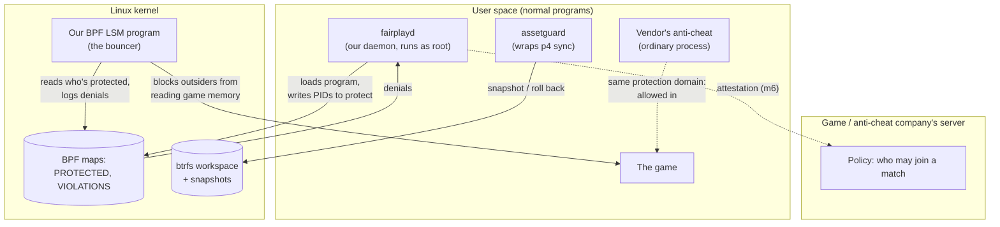

# fairplay-os, explained

A plain-English tour of what's in this repo, how the pieces fit, and what every
acronym means. The [README](../README.md) has the commands; this file has the
"why"; the [design doc](design.md) is the plan everything follows. Terms in
**bold** are in the [glossary](#glossary) at the bottom.

## The one-paragraph version

We're prototyping a Linux setup for people who both *make* games and *play*
them. It has three jobs. **A:** keep huge game-asset checkouts from getting
half-broken when a download dies midway. **B:** let the operating system itself
protect a running game from cheat tools, and later prove to a game server that
it did, so anti-cheat companies don't need to install their own code into the
kernel. **C:** keep the game smooth while big background jobs (compiles, asset
syncs) run. Everything is developed in a Linux virtual machine on a Mac.

## Where things stand

| # | Milestone | State | How to see it work |
| --- | --- | --- | --- |
| 1 | VM baseline | Done | `./vm/check-milestone1.sh`, then `lsm-hello` (README) |
| 2 | assetguard vs a real Perforce server | Done | `./vm/test-milestone2.sh` |
| 3 | Protected process | Done | `cheatsim` + `fairplayd` (README) |
| 4 | fairplayd socket API | Done | `./vm/test-milestone4.sh` |
| 5 | Block `/dev/uinput` during a session | Not started | |
| 6 | Attestation | Blocked: the VM has no TPM | |
| 7 | Executable-mapping allowlist | Stretch | |

## The big picture

The rule that shapes everything in Part B: **the kernel enforces, user space
decides, the server sets policy.** Our kernel program is a dumb bouncer that
checks a list. `fairplayd` decides what goes on the list. The game company's
server decides whether a machine with a given setup may join ranked play. No
anti-cheat company ships kernel code.

## Part A: the file layer

**The problem.** Game studios keep code and art in **Perforce**, often hundreds
of GB per checkout. If a `p4 sync` (the download) is killed halfway, by a crash,
a full disk or a dropped network, you're left with a mix of old and new files
and some files cut off partway through. The game editor then crashes or, worse,
silently saves corrupted assets.

**What we built.**

- **`safewrite`** (a library, done). A safe way for our own tools to write a
  file: write to a temporary file next to it, **fsync** it to disk, then
  **rename** it over the original. A rename is all-or-nothing, so after a crash
  you have either the whole old file or the whole new one, never half of each.
- **`assetguard`** (a command-line tool). Wraps `p4 sync` in four steps:
  1. **Snapshot** the workspace. It lives on **btrfs**, which can freeze an
     instant, read-only copy of a whole directory tree without copying any data.
  2. **Sync** as normal.
  3. **Verify**: ask the server for the **MD5** fingerprint and size of every
     file, then check what's actually on disk. A cut-off file fails this. Bad
     files get one re-download attempt.
  4. **Case-check**: flag names that differ only in capitals (`Hero.png` vs
     `hero.png`). Linux treats those as two files, but Windows and Mac don't, so
     they break teammates on those systems.

  If any step fails, it **rolls back**: the broken workspace is moved aside
  (kept as `ws.failed-<time>` so you can look at it), the snapshot is put back
  in its place, and the Perforce server's record of what you have (the **have
  list**) is reset to match.

**Why the have list matters.** Perforce doesn't look at your disk to decide
what to download; it trusts its own record of what you have. If we restored
the files but not that record, the server would think you already had the new
versions. `p4 sync` would then say "up to date" and leave you on old files,
and worse, `p4 reconcile` would see your old files as *your edits*, so a
submit would quietly revert teammates' work. So before every sync, assetguard
saves the have list next to the snapshot (`pre-sync-<time>.have`), and
rollback puts it back exactly with `p4 flush`.

**Milestone 2's test** (`vm/test-milestone2.sh`) starts a throwaway Perforce
server, makes a depot with two versions of some files, and syncs a fresh btrfs
workspace to version 1. Then it tries four ways to break a sync to version 2:

| Scenario | What happens | Expected |
| --- | --- | --- |
| p4 killed mid-sync | One file updates, the next is cut off, p4 dies | Roll back |
| File keeps arriving truncated | The re-download is cut off too | Roll back |
| File arrives truncated once | The re-download works | Sync succeeds |
| Depot gains `Hero.uasset` next to `hero.uasset` | Case collision | Roll back |

The faults come from a stand-in `p4` that assetguard uses instead of the real
one (via the `ASSETGUARD_P4` variable). After each scenario the test asks
**Perforce itself**, not assetguard, whether the client is consistent: the
have list must match the expected version exactly, and `p4 reconcile -n` must
find no file on disk that differs from it.

**Limits of v0.** If the machine dies *during* a rollback (between moving the
workspace aside and restoring the snapshot), you'll find `ws` missing and
`ws.failed-*` plus the snapshot present, and need to finish the job by hand.
Old snapshots and failed workspaces aren't cleaned up automatically yet.
Rollback swaps the whole workspace, so close the editor (and `cd` out of the
workspace) first.

## Part B: fairness primitives

**The problem.** Cheats work by reading or changing a game's memory from
another program, for example to find where enemies are. Anti-cheat companies
fight this today by installing their own kernel drivers. These are powerful,
invasive, and a crash or security hole in one takes down the whole machine.

**Our approach.** Use a hook the Linux kernel already has. **LSM** hooks are
checkpoints the kernel passes through before sensitive actions, and with
**BPF LSM** we can attach a small, safety-checked program to one. Ours sits on
`ptrace_access_check`, the single checkpoint for *every* way one process can
read another's memory:

| Attack path | What it is |
| --- | --- |
| **ptrace** attach + peek | The debugger interface (what `gdb` uses) |
| `process_vm_readv` | A system call that copies memory out of another process |
| `/proc/<pid>/mem` | A file that *is* another process's memory |

**The pieces.**

- **`fairplay-ebpf`**: the bouncer, running inside the kernel. On every memory
  access it asks: is the target in the `PROTECTED` list? Is the caller the same
  process, or in the same *protection domain* (the game's own anti-cheat)? If
  not, it says no (**EPERM**) and writes a record to `VIOLATIONS`.
- **`fairplay-common`**: the shared shape of those records, so the kernel side
  and the user side agree byte for byte.
- **`fairplayd`**: the **daemon**. It loads the bouncer, writes PIDs into the
  list, prints a `DENIED` line for each record, and answers games and
  anti-cheat programs over a socket (milestone 4, below). Protection ends
  when it exits, so a crashed `fairplayd` fails open, not closed.
- **`fairplayctl`** (in `crates/fairplay-api`): a small command-line client
  for that socket, for people and tests.
- **`cheatsim`**: the test cheat. `cheatsim game` holds a secret number in
  memory; `cheatsim attack` tries all three paths to read it. It runs as
  **root** on purpose: normally root may read anything, so a block proves it
  was our program that did it.
- **`lsm-hello`**: milestone 1's smoke test. It logs every file `cat` opens,
  which proves the whole BPF LSM toolchain works end to end.
- **`fairplay-attest`**: milestone 6, outline only. The plan: the **TPM** chip
  records what booted (**measured boot**) and **IMA** records which programs
  ran. On request, the TPM signs those records (a **quote**) and the game
  company's server checks them: was it a known kernel, was `fairplayd` running,
  was our bouncer loaded? The OS only reports facts; the server decides.

### The socket API (milestone 4)

Programs talk to `fairplayd` through a **Unix domain socket**,
`/run/fairplayd.sock`: a file-like address that only programs on the same
machine can connect to. Each request and each answer is one line of
**JSON**. The calls follow the design doc's "vendor-facing API":

- **`launch_protected`**: "start this game, protected". Only a *launcher*
  may ask: root, or a member of the `fairplay-launcher` group. `fairplayd`
  starts the program itself, so there's no moment where the game runs
  unprotected: it **forks** a child, the child waits on a pipe, `fairplayd`
  puts the child's PID in the `PROTECTED` list, and only then lets the child
  switch to the launcher's user and start the game. The game never runs as
  root unless root explicitly asks for that. Variables like `LD_PRELOAD`,
  which tell Linux to load extra code into a program, are dropped (the
  design doc's "clean launch environment"), and the game gets
  **no_new_privs**, so it can't gain privileges later. With `join`, the
  launcher starts a second program *inside* the game's protection domain:
  that's how the vendor's anti-cheat gets permission to inspect the game.
- **`session_status`**: is it protected? Plus the game's state (running, or
  its exit code), who's in its domain, how many attempts were blocked, the
  kernel's **lockdown** mode, and whether any virtual input devices (fake
  keyboards and mice, the kind aimbots make) exist. Called without a session,
  it answers about the caller's own session, which is what an anti-cheat
  sitting next to the game wants.
- **`violations`**: a live **stream**. The caller subscribes once, and every
  denied attempt is pushed to it as it happens: which process, which
  executable, which hook. Vendors get detection signal without a driver.
- **`attest`**: will return the TPM's signed report (milestone 6). The VM has
  no TPM, so for now it answers `unavailable`, honestly, and echoes the
  nonce it was given.

**How it knows who's calling.** The kernel tells it. When a program
connects, `fairplayd` asks the kernel for the caller's process ID, user and
groups (**SO_PEERCRED**, **SO_PEERGROUPS**); nothing in a request can claim
to be someone else. Each user sees only their own sessions; root sees all.
The game's own anti-cheat (a process in the session) may see its session too.

**Cleaning up.** When a protected program exits, `fairplayd` removes its PID
from the list *before* **reaping** it. Until it's reaped, the exited process
is a **zombie** whose PID the kernel won't hand out again, so a new, unrelated
process can never inherit the protection.

**Milestone 4's test** (`vm/test-milestone4.sh`) plays every part: a launcher
starts `cheatsim game`, a mock anti-cheat (a short Python script that speaks
the JSON directly) joins its domain and subscribes to violations, and
`cheatsim attack` runs as root. The attack must leak nothing, and the mock
vendor must receive exactly three events, one per attempt, each naming the
process, its executable and the hook.

"Which executable" is read inside the kernel, like the process name, because
the attacker is often gone by the time `fairplayd` could look it up. The BPF
program follows `task->mm->exe_file` to the file's name. Those structs are
among the ones whose layout moves between kernels, so `fairplay-ebpf/build.rs`
finds each field in `vmlinux.rs` at build time, the same trick as
`lsm-hello-ebpf`. The full path is added from user space when the caller is
still running.

**"Best-effort"** is deliberate. Someone with physical access and a custom
kernel can defeat any of this. The point is that attestation then *shows* a
different kernel, and the server can act on that.

### Lessons learned writing BPF programs

- **The verifier** checks every program before the kernel will run it. For LSM
  programs, it must be able to prove the return value is 0 or a small negative
  error code. Returning through Rust's `Result<i32, _>` hides the sign from
  it, so the hook functions build their `i32` verdict directly. Both crates
  have a comment on this.
- Grab information about the caller (such as its **comm**) *inside* the BPF
  program. By the time `fairplayd` reads the event, a short-lived attacker has
  usually exited.
- Kernel structs change shape between versions. `struct file`'s `f_path` is
  a plain field on the VM's 6.8 kernel, but on 7.0 (which CI found) it sits
  inside an anonymous union. Our programs are compiled against one kernel's
  layout (`vmlinux.rs`) rather than using **CO-RE** (relocations that let one
  binary adapt at load time). So `lsm-hello-ebpf/build.rs` works out where
  the field lives at build time. Prefer fields that rarely move, like
  `task_struct.tgid`.

## Part C: resource lanes

Not started. The idea is to put the game in an "interactive" **cgroup** and
compiles/syncs in a "background" one, so the kernel gives the game priority
for CPU, memory and disk. We'll measure this on real hardware with a GPU; frame
times inside a VM only measure the VM.

## The VM

Everything runs in an arm64 (ARM processor) Ubuntu VM on an Apple Silicon Mac
mini.

- `vm/macos/create-vm.sh` and `run-vm.sh` run **on the Mac**. They use
  **QEMU** with Apple's **HVF**, so the VM runs at near-native speed. Firmware
  is **UEFI** (**edk2**), first-boot setup is **cloud-init**, and a second
  virtual disk holds the btrfs workspace.
- `vm/provision-guest.sh` runs **inside the VM** once. It installs the tools,
  adds `bpf` to the kernel's LSM list, turns on IMA, and formats the workspace.
- `vm/check-milestone1.sh` checks all of that.

**Known gaps:**

- **No TPM.** QEMU's virtual TPM device crashes under HVF on this Mac, so the
  VM boots with `TPM=off`. That blocks milestone 6.
- **No Secure Boot.** Homebrew's ARM firmware has no Secure Boot keys, so
  milestone 6 will test "reject a different kernel" instead of "reject Secure
  Boot off".

## Why the BPF crates build separately

A BPF program isn't a normal Linux program. It's compiled for a made-up CPU
(the `bpfel-unknown-none` **target**) that only the kernel runs. That needs:

- **nightly** Rust plus **rust-src**, so Rust can rebuild its core library
  for that CPU (**build-std**);
- **bpf-linker** to produce the final object file;
- **`vmlinux.rs`**: Rust versions of the kernel's internal structs, generated
  from the running kernel's **BTF** by **aya-tool**, which calls **bindgen**.
  It's specific to each kernel, so it's not checked in.

So `crates/fairplay-ebpf` and `crates/lsm-hello-ebpf` are their own Cargo
workspaces, excluded from the main one. Each pairs with a normal user-space
crate that loads it using **aya**.

## What CI checks

Every pull request (and every push to `master`) runs
`.github/workflows/ci.yml` on GitHub's Ubuntu 24.04 x86_64 machines:

| Job | What it proves |
| --- | --- |
| User space | Formatting, clippy (warnings are errors), all unit tests, release builds |
| eBPF programs | Both BPF programs build, format and lint cleanly against the runner's kernel, and each contains its LSM hook |
| Milestone 2 | The full `vm/test-milestone2.sh`, on a throwaway btrfs disk image with a real `p4d` |
| Shell scripts | `shellcheck` on everything in `vm/` |

**What it can't prove:** GitHub's machines don't boot with BPF LSM turned on,
so CI can't *load* our BPF programs. Milestones 1, 3 and 4 (and later 5)
are still tested on the VM, as in the README. If a PR touches
`crates/*-ebpf` or `fairplayd`, run those before merging.

Tool versions are pinned in both CI and `vm/provision-guest.sh`. This
includes the exact Rust nightly, in each eBPF crate's `rust-toolchain.toml`.
A new upstream release can't break a build on its own; updating is a
deliberate change to both files.

## Glossary

**Kernel and BPF**

- **Kernel / user space**: the kernel is the core of the OS that controls
  hardware and enforces rules. User space is every normal program, including
  root's.
- **BPF / eBPF**: a way to run small, verified programs inside the kernel
  without writing a kernel module. "e" = extended; today the two names mean the
  same thing.
- **Verifier**: the part of the kernel that checks a BPF program can't crash,
  loop forever, or read memory it shouldn't, before allowing it to load.
- **LSM** (Linux Security Module): the kernel's built-in system of security
  checkpoints ("hooks") such as `file_open` and `ptrace_access_check`.
  AppArmor and SELinux are LSMs.
- **BPF LSM**: an LSM that lets BPF programs attach to those hooks. It must be
  listed in the kernel's `lsm=` boot setting; ours is.
- **BTF** (BPF Type Format): a description of the kernel's internal data
  structures, published at `/sys/kernel/btf/vmlinux`.
- **vmlinux**: the kernel itself. `vmlinux.rs` is our generated Rust copy of
  the struct layouts we need from it.
- **Map**: storage shared between a BPF program and user space. `PROTECTED`
  is a hash map; `VIOLATIONS` is a **ring buffer**, a fixed-size queue of
  events.
- **aya**: the Rust library we use to write BPF programs (`aya-ebpf`) and load
  them (`aya`). `aya-log` carries `info!` lines from the kernel side to the
  loader.
- **aya-tool**, **bindgen**, **bpf-linker**: build tools; see
  [above](#why-the-bpf-crates-build-separately).
- **Hook**: a point in the kernel where our program gets called.
- **CO-RE** (Compile Once, Run Everywhere): BPF relocations that let one
  compiled program adapt to each kernel's struct layout at load time. We don't
  use it yet, so programs are built per kernel.
- **EPERM** / **EACCES**: "operation not permitted" / "permission denied"
  error codes.
- **cgroup** (control group, v2): the kernel's way to group processes and give
  each group a share of CPU, memory and I/O.
- **uinput**: `/dev/uinput` lets a program create a fake keyboard or mouse.
  Aimbots use it, which is why milestone 5 blocks it during a protected session.
- **lockdown**: a kernel mode that stops even root from changing the running
  kernel.

**Processes**

- **PID / TGID**: process ID. In the kernel each *thread* has a PID, and the
  TGID (thread-group ID) is what user space calls the process's PID. We key
  everything on TGID.
- **comm**: a process's short name (up to 15 characters), e.g. `cat`.
- **root**: the all-powerful administrator account. `sudo` runs a command
  as root.
- **ptrace**: the debugging interface that lets one process stop, read and
  modify another.
- **inode**: the file itself, as opposed to its name. A program that has a
  file open keeps the old inode even after the name points somewhere new.
- **Daemon**: a program that runs in the background and serves requests.
  `fairplayd` is one (the "d" is for daemon).
- **uid / gid**: user ID and group ID, the numbers Linux uses for accounts
  and groups. Root is uid 0. A process also has *supplementary groups*.
- **fork / exec**: how Linux starts programs. `fork` makes a copy of the
  running process; `exec` replaces that copy with a new program, keeping its
  PID.
- **Reap / zombie**: a finished process stays as a *zombie* (just its exit
  code and PID) until its parent *reaps* it by collecting that code. Only then
  can the PID be reused.
- **no_new_privs**: a per-process flag that stops it, and anything it starts,
  from gaining privileges (e.g. through setuid programs).
- **Protection domain**: the set of processes allowed to read each other: a
  game and its anti-cheat. Each launch gets its own.
- **Session**: one `launch_protected` game plus anything launched into its
  domain, as `fairplayd` tracks it.

**The socket API**

- **Unix domain socket**: a connection point that looks like a file
  (`/run/fairplayd.sock`) but carries messages between programs on the same
  machine, like a local network connection.
- **SO_PEERCRED / SO_PEERGROUPS**: ways to ask the kernel who is on the
  other end of a Unix socket: their process ID, uid, gid and groups. The
  caller can't fake them.
- **SCM_RIGHTS**: passing open files over a Unix socket. `fairplayctl launch`
  hands over its terminal this way, so the game's output appears there.
- **File descriptor (fd)**: a process's handle to an open file, pipe or
  socket. 0, 1 and 2 are stdin, stdout and stderr.
- **JSON**: a plain-text data format (`{"op":"attest","nonce":"00ff"}`), easy
  for any language to read and write.
- **Stream / subscribe**: instead of asking repeatedly, the client asks once
  and the daemon keeps sending events on the same connection.
- **tokio**: the Rust library `fairplayd` uses to serve many connections at
  once.
- **setpriv**: a command that runs another with a chosen uid, gid and groups.
  The milestone 4 test uses it to act as a launcher without changing your
  account.

**Trust and attestation**

- **TPM** (Trusted Platform Module): a tamper-resistant chip (or chip-like
  firmware) that records measurements and signs statements about them.
  **swtpm** is a software TPM for VMs.
- **PCR** (Platform Configuration Register): a slot in the TPM that can only
  be *extended*, never set, so it ends up as a fingerprint of everything
  recorded into it.
- **Measured boot**: each stage of boot records a fingerprint of the next stage
  into PCRs before running it.
- **Secure Boot**: firmware refuses to boot software that isn't signed by a
  trusted key. That's a separate feature from measured boot.
- **IMA** (Integrity Measurement Architecture): the kernel records a
  fingerprint of programs as they run, extending PCR 10. `ima_policy=tcb` is
  the built-in rule set we use.
- **Quote**: a TPM-signed statement of current PCR values plus a fresh random
  number (**nonce**) from the server, so it can't be replayed.
- **AK** (Attestation Key): the TPM key that signs quotes.
- **Attestation**: proving to a remote party what software a machine is running.

**Files and Perforce**

- **btrfs**: a Linux filesystem with cheap snapshots. A **subvolume** is a
  directory tree btrfs can snapshot on its own; ours is `/work/ws`.
- **Snapshot**: an instant point-in-time copy that shares data with the
  original until either side changes.
- **fsync**: forcing data out of memory caches onto the disk.
- **Perforce / Helix Core**: version control that games studios use for huge
  binary files. **p4** is the client command; **p4d** is the server.
- **Depot**: the server's repository. Depot paths look like `//depot/Art/...`.
- **Client / workspace**: your local checkout, and the server-side record of
  how depot paths map to your disk.
- **Have list**: the server's record of which revision of each file you have.
  If it's wrong, the next sync skips files you actually need. `p4 have`
  prints it.
- **`p4 sync`**: download files to match the depot. `-f` forces a
  re-download.
- **`p4 flush`**: update the have list *without* downloading anything. We use
  it to reset the have list after a rollback.
- **`p4 fstat -Ol`**: list file metadata, including size and MD5 **digest**.
- **`p4 reconcile -n`**: "what would I need to submit to make the depot match
  my disk?", without doing it. Empty means disk and have list agree.
- **Revision / changelist**: `file#3` is the third version of one file;
  `//...@2` is every file as of submitted change 2.
- **ztag** (`p4 -ztag`): Perforce's machine-readable output format,
  `... key value` lines.
- **MD5 / digest**: a fingerprint of a file's contents. Any change, including
  truncation, changes it.
- **+k / ktext**: file types where Perforce rewrites `$Id$`-style keywords on
  download, so the local file legitimately differs from the server's digest.
  **utf16** files are also converted on download. assetguard skips both.

**VM and build**

- **CI** (continuous integration): a server that builds and tests every
  change automatically. Ours is **GitHub Actions**; a **workflow** is its
  config file, a **job** one machine's worth of steps, a **runner** that machine.

- **VM** (virtual machine): a computer emulated in software.
- **QEMU**: the VM software. **HVF** (Hypervisor.framework) is Apple's API
  that lets QEMU use the CPU's hardware virtualization.
- **arm64 / aarch64**: the ARM 64-bit CPU architecture (Apple Silicon).
- **UEFI**: modern PC firmware. **edk2** is the open-source implementation
  QEMU ships.
- **cloud-init**: first-boot setup for cloud images (creates the user, installs
  the SSH key).
- **Cargo workspace**: a group of Rust crates built together. **Crate**: one
  Rust package.
- **nightly**: the daily-build Rust toolchain, needed for BPF.
  **rust-src**: Rust's standard library source code.
  **build-std**: rebuild that library for an unusual target.
- **Target**: the CPU/OS a program is compiled for, e.g. `bpfel-unknown-none`
  (little-endian BPF, no OS).
