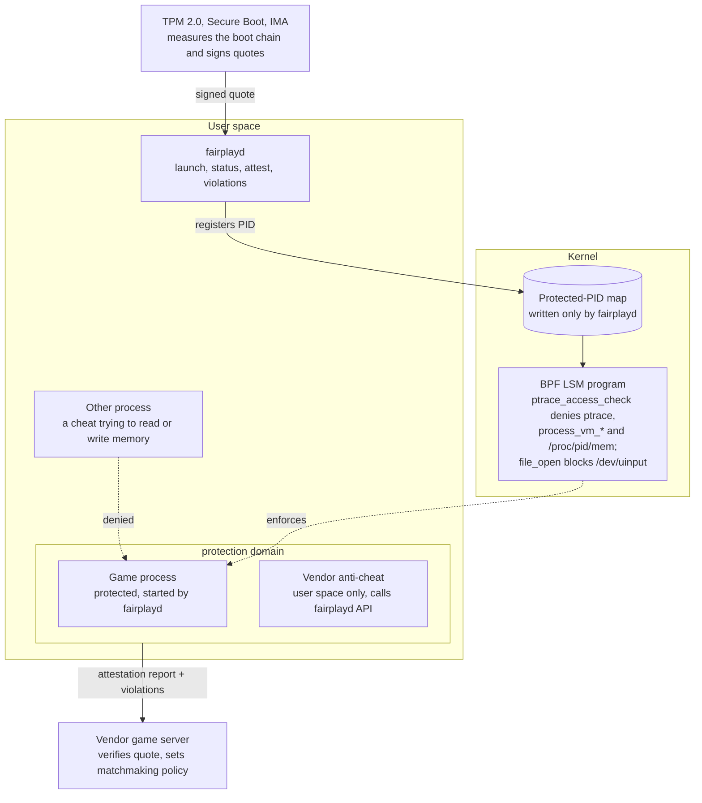

# Gaming Workstation OS: Design Doc

*Oct 28, 2026 · Terry*

> This is the project's design doc, converted from the original PDF. The
> prototype adapts a few milestone tests to the VM it runs on (no TPM or Secure
> Boot under QEMU on Apple Silicon); [CLAUDE.md](../CLAUDE.md) lists those
> adaptations. For a plain-English tour and a glossary, see
> [GUIDE.md](GUIDE.md).

## Overview

We build a Linux-based workstation OS, not a new kernel, that fixes two things
Windows does badly for game teams. The first is file handling for huge,
version-controlled asset trees. The second is a fair-play foundation that
anti-cheat vendors build on, instead of each shipping their own kernel driver.
Both pieces get prototyped in Rust on a Linux VM before we decide whether they
belong in one distro.

## Problems we are solving

- A p4 sync fails with sharing violations when an editor or tool holds a file
  handle.
- Large binaries get truncated or corrupted mid-write by scanners, crashes, or
  killed tools, and we find out at cook or load time.
- Assets authored on case-insensitive Windows collide on case-sensitive
  filesystems.
- Kernel anti-cheat means every vendor ships ring-0 code: a large attack
  surface and a stability risk for players.

## Goals

- Syncs that never leave a half-written file in the workspace, with corruption
  detected before anyone loads it.
- OS-level primitives that make memory reading, code injection, and synthetic
  input hard for other processes, with no vendor kernel code.
- A remote attestation report a game server can use as a matchmaking signal, so
  fairness is best-effort and policy lives server-side.
- Debugging and profiling stay easy on dev builds: protection is opt-in per
  launch.

## Non-goals

- A new kernel or a replacement for Windows on player machines.
- Console SDK support. That depends on platform holders, not on us.
- Guaranteed cheat prevention. A determined cheater with hardware access still
  wins; we raise the cost.

**Why Linux underneath:** drivers, Vulkan, and Proton already exist. The kernel
already has the hooks we need: BPF LSM for access control, IMA and TPM for
measurement, and lockdown mode for kernel integrity.

## Part A: Dev workstation file layer

The workspace becomes something a sync can never half-break: every sync is
snapshotted, staged, verified against Perforce's own digests, then swapped in.
A tool we call `assetguard` wraps `p4 sync` to do this; nothing in the editor
or the engine has to change.

### Storage

- Each workspace lives on its own btrfs subvolume. btrfs checksums every block,
  so silent bit-rot surfaces as a read error instead of a broken asset.
- Snapshots are copy-on-write, so a snapshot of a 500 GB workspace is
  near-instant and costs no space until files change.
- No on-access virus scanner on the workspace volume. Scans run on read-only
  snapshots, out of band, so they never hold a handle during a sync.

### The sync flow

1. Snapshot the workspace subvolume, so any sync can be rolled back in seconds.
2. Run `p4 sync` and let Perforce write files the Unix way: a new inode, then a
   rename over the old name. Tools holding the old file keep reading the old
   inode; nothing gets a sharing violation.
3. Verify each synced file against the have-revision digest and size from
   `p4 fstat -Ol`. A mismatch is re-fetched with a forced sync of that one file.
4. Run the case-collision check (below) on the changed paths.
5. Emit a change notification so the editor hot-reloads what changed, instead
   of silently holding stale inodes.
6. On any failure the sync rolls back to the snapshot and reports which files
   failed.

### Writes from our own tools

A small Rust crate gives every in-house tool one safe write path: write to a
temp file in the same directory, fsync it, then rename over the target. A crash
mid-write leaves the old file intact. Tools we don't control are covered by the
post-sync verify and by `p4 diff -se`, which lists unopened files that no
longer match the depot.

### Case collisions

- Before submit and after each sync, flag any two paths that differ only by
  case (`Texture.png` vs `texture.png`).
- For teams that need Windows-like behavior, ext4 supports per-directory case
  folding. That trades away btrfs checksums and snapshots, so it is an open
  question rather than the default.

## Part B: Fairness primitives

The OS protects a game process from other processes and reports, through a
signed attestation, whether that protection can be trusted. Anti-cheat vendors
run entirely in user space on top of it. Fairness is best-effort: the server
decides what an unattested machine may do, such as casual queues only.

**Anti-cheat runs in user space; the kernel enforces and the TPM vouches.**

*Fairness architecture: user space, kernel, hardware. The cheat's memory access
dies at one kernel hook; the vendor only ever talks to `fairplayd` and its own
server.*

### Threat model

| Threat | How cheats do it today | Our answer | In scope |
| --- | --- | --- | --- |
| Reading game memory (wallhacks, ESP) | `ptrace`, `process_vm_readv`, `/proc/<pid>/mem` | Deny in one BPF LSM hook | Yes |
| Writing memory or injecting code | Same paths, plus `LD_PRELOAD` at launch | Same hook; clean launch environment; executable-mapping allowlist (stretch) | Yes |
| Synthetic input (aimbots, triggerbots) | A virtual device via `/dev/uinput` | Block uinput during a protected session; report any virtual device present | Yes |
| Disabling the protection | Root unloads the program or boots a patched kernel | Not preventable on an open machine; detected by attestation | Detected only |
| Hardware cheats | DMA cards, a second PC reading a capture feed | Server-side detection and IOMMU later | No |

### Protected processes

A privileged launcher starts the game and registers its process ID in a kernel
map. A BPF LSM program on the `ptrace_access_check` hook denies any access to a
registered process from outside its protection domain. That one hook covers
ptrace attach, `process_vm_readv` and `process_vm_writev`, and reads of
`/proc/<pid>/mem`, because the kernel routes all of them through the same
access check. The protection domain is the game plus the vendor's anti-cheat
process.

### Attestation

The fairness daemon answers a server nonce with a TPM 2.0 quote over the boot
measurements: Secure Boot state, the kernel, and whether lockdown mode is on.
The IMA log adds hashes of the daemon binary and the loaded BPF program. The
vendor's server verifies the quote and the log, then sets matchmaking policy.
The OS never decides whether a player is cheating.

### Vendor-facing API

A small local socket API, owned by a daemon called `fairplayd`:

- `launch_protected(exe, args)`: start a game in a protection domain; launcher
  only.
- `session_status()`: protected or not, lockdown state, virtual input devices
  present.
- `attest(nonce)`: the TPM quote and event log for the vendor's server.
- `violations()`: a stream of denied attempts: which process, which
  executable, which hook. Vendors get detection signal without a driver.

## Part C: Resource lanes

The OS sorts every process into an interactive lane or a background lane, so
the game or editor always wins contention for CPU, memory, and disk. This
matters most for players, whose machines carry launchers, updaters, chat
overlays, browsers, and cloud sync alongside the game. Developers get the same
benefit when a build or shader compile runs under the editor.

Dropping Windows removes much of the baseline overhead: on-access scanning,
indexing, and update services. It does not remove contention between the
things the user chose to run, which is where frame-time spikes come from.

### Mechanism: existing kernel parts, our policy

- cgroups v2 give each lane a CPU weight, an I/O weight, and memory settings.
  The interactive lane gets a protected memory floor, so a background download
  or cook can't push the game's working set out of RAM.
- `sched_ext` allows a gaming-tuned CPU scheduler loaded as a BPF program, if
  the default scheduler isn't enough. It is an option to evaluate, not a
  starting requirement.
- A small Rust daemon, `lanesd`, places processes into lanes at launch.
  `fairplayd` already launches games, so protected games land in the
  interactive lane by default.

### Lanes

| Lane | Players | Developers | Gets |
| --- | --- | --- | --- |
| Interactive | The game, its anti-cheat, voice chat | Editor, running game, debugger | High CPU and I/O weight; protected memory floor |
| Background | Launchers, updaters, downloads, browser, cloud sync | Builds, shader compiles, asset cooks, p4 sync | Uses idle capacity; yields under contention |

### Prove it before building it

1. Measure frame-time consistency (1% lows and spikes) with a realistic
   background load: a game download, a browser with video, and a cloud sync.
   Run once with no policy.
2. Repeat for developers: editor frame times and input latency with a full
   build running.
3. Repeat both with the two lanes applied by hand through cgroups. Build
   `lanesd` only if the lanes measurably beat no policy.

## Rust prototype plan

One Cargo workspace, six crates, built and tested on a QEMU VM with a virtual
TPM. Every milestone ends with a test that a skeptic can run.

| Crate | What it does | Key dependencies |
| --- | --- | --- |
| `assetguard` | Snapshot, sync, verify, case-check, roll back | p4 CLI with `-ztag`, btrfs tooling |
| `safewrite` | Temp-file, fsync, rename write path for in-house tools | std only |
| `fairplay-ebpf` | BPF LSM program on `ptrace_access_check`; protected-process map | aya-ebpf |
| `fairplayd` | Loads the program, owns the map, serves the socket API, logs violations | aya, tokio |
| `fairplay-attest` | TPM quote plus IMA log, and a verifier for the server side | tss-esapi |
| `cheatsim` | Plays the attacker: every memory, injection, and input path in the threat model | nix |

### Milestones

1. **VM baseline.** A 6.x kernel with `CONFIG_BPF_LSM` and `bpf` in the `lsm=`
   boot list, OVMF with Secure Boot, swtpm as the TPM, and a btrfs workspace
   volume. Exit: a hello-world LSM program loads and logs.
2. **assetguard v0.** Snapshot, sync, and digest-verify against a test depot.
   Exit: truncate a synced file mid-sync, and the run detects it and rolls back.
3. **Protected process v0.** Exit: cheatsim fails on `ptrace`,
   `process_vm_readv`, and `/proc/<pid>/mem` against a protected test game, and
   succeeds against an unprotected one.
4. **API and violations.** `fairplayd` serves the four calls. Exit: a mock
   vendor client sees each cheatsim attempt in the violation stream.
5. **Input.** Block `/dev/uinput` opens during a session and report existing
   virtual devices. Exit: a uinput-based clicker cannot start mid-match.
6. **Attestation v0.** Exit: the verifier accepts a quote from the clean VM and
   rejects one after booting with Secure Boot off.
7. **Stretch: executable allowlist.** Deny executable mappings into the game
   from files outside its install and system library paths.

## Risks and open questions

The biggest risk is that protection on an open machine is advisory: root can
unload the BPF program or edit its map. We accept that and lean on attestation
to tell the server whether the machine was locked down.

- **Root bypass.** Any user with `CAP_BPF` can detach the program. Should
  lockdown mode plus a signed-kernel policy be required for an attested
  session, and how much does that cost dev machines?
- **Debugging dev builds.** Developers must attach debuggers and profilers
  freely. Protection stays opt-in per launch; we need a clear rule that
  shipping builds request it and dev builds never do.
- **Proton games.** Wine's helper processes talk to the game process. Which of
  them belong in the protection domain, and does the hook break anything they
  do?
- **Privacy.** A TPM quote can identify a machine. We need an attestation key
  scheme that proves state without becoming a permanent hardware ID.
- **Case folding vs checksums.** ext4 case folding and btrfs checksums don't
  come together. Do we pick one, or detect collisions and leave the filesystem
  case-sensitive?
- **Perforce server case mode.** Mixed Windows and Linux clients behave
  differently depending on how the server handles case. Which mode does the
  studio depot use?
- **Vendor adoption.** The primitives only matter if one anti-cheat vendor
  builds on them. Who do we show the milestone 4 demo to first?

Deliberately left out: hardware and DMA cheats, computer-vision aimbots on a
second device, and anything that belongs in server-side validation.
