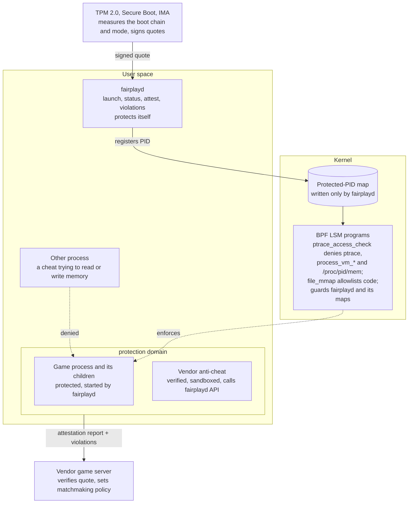

# Gaming Workstation OS: Design Doc

*Oct 28, 2026 · Terry · revised Oct 30, 2026: the OS now replaces Windows on
player PCs too*

> This is the project's design doc, converted from the original PDF. The
> prototype adapts a few milestone tests to the VM it runs on (no TPM or Secure
> Boot under QEMU on Apple Silicon); [CLAUDE.md](../CLAUDE.md) lists those
> adaptations. For a plain-English tour and a glossary, see
> [GUIDE.md](GUIDE.md).

## Overview

We build a Linux-based OS, not a new kernel, that replaces Windows on player
PCs and on game-dev workstations. Its main promise to players: competitive
games without kernel-level anti-cheat. Gamers dislike kernel anti-cheat for
good reasons. It puts each vendor's code at ring 0, where one bug crashes the
machine or hands attackers the kernel, and it can see everything on the PC.
We replace it with a small fair-play foundation in the OS that anti-cheat
vendors build on from user space. The same OS fixes what Windows does badly
for game teams: file handling for huge, version-controlled asset trees. Every
piece gets prototyped in Rust on a Linux VM first, then on real x86 hardware.

## Problems we are solving

For players:

- Kernel anti-cheat means every vendor ships ring-0 code: a large attack
  surface and a stability risk. Vendor drivers have been abused by malware
  (Genshin Impact's `mhyprot2` was used by ransomware to kill antivirus).
- Kernel anti-cheat can see the whole machine: files, other programs, browser
  data. Players have to trust each vendor not to look.
- Launchers, updaters, overlays, browsers, and cloud sync compete with the
  game and cause frame-time spikes.

For developers:

- A p4 sync fails with sharing violations when an editor or tool holds a file
  handle.
- Large binaries get truncated or corrupted mid-write by scanners, crashes, or
  killed tools, and we find out at cook or load time.
- Assets authored on case-insensitive Windows collide on case-sensitive
  filesystems.

## Goals

- **No vendor kernel code.** OS-level primitives make memory reading, code
  injection, and synthetic input hard for other processes. The kernel code is
  ours, small, open, and checked by the BPF verifier, the same for every game.
- **Less vendor visibility than Windows.** The vendor's anti-cheat sees the
  game and nothing else on the machine.
- **A remote attestation report** a game server can use as a matchmaking
  signal, without becoming a hardware ID. Fairness is best-effort and policy
  lives server-side.
- **A daily-driver desktop for players.** Windows games run through Proton,
  ordinary consumer hardware works (NVIDIA included), Discord, Spotify, and a
  browser run alongside the game, updates roll back, and nothing needs a
  terminal.
- **The owner stays in charge.** A game never changes the OS's mode or
  settings; it can only ask, and the user decides.
- **Developer machines stay open.** Syncs never leave a half-written file, and
  debugging and profiling stay easy in developer mode.

## Non-goals

- A new kernel.
- Console SDK support. That depends on platform holders, not on us.
- Guaranteed cheat prevention. A determined cheater with hardware access still
  wins; we raise the cost.
- Running games whose anti-cheat requires a kernel driver. They won't run, and
  we don't emulate one. Getting those vendors onto our primitives is the
  adoption problem (see Risks).
- Locking owners out of their machines. Player mode limits what root can do to
  the fairness machinery, not what the owner can install or configure.

**Why Linux underneath:** drivers, Vulkan, and Proton already exist. The kernel
already has the hooks we need: BPF LSM for access control, IMA and TPM for
measurement, and lockdown mode for kernel integrity. Easy Anti-Cheat and
BattlEye already run in user space under Proton, which is the model we build
on.

## Modes: player and developer

On a player's PC the owner has root, and the owner may be the cheater. On a
developer's PC the owner needs debuggers, `sudo`, and unsigned code. One
machine can't credibly be both at once, so the OS boots into one of two modes,
and attestation tells the game server which one.

| | Player mode | Developer mode |
| --- | --- | --- |
| Default | Yes | Chosen at boot, like Chromebook developer mode |
| System image | Signed, read-only, measured at boot | Writable; unsigned kernels and modules allowed |
| Kernel lockdown | On (integrity) | Off or user's choice |
| Root | Exists, fenced away from the fairness machinery | Unrestricted |
| Debuggers | Work on unprotected processes | Work on everything |
| Attestation says | Player mode, known image | Developer mode |
| Typical server policy | Ranked and casual | Casual, or dev servers only |

### Entering player mode

A running system can't prove it is clean: once root or unsigned code has run
since boot, it could have changed anything, and the measurements start at
boot. So the only way into player mode is a boot into player mode.

- **Games ask; they don't switch.** A game calls `session_status` or `attest`
  and its server decides what an unattested machine may do. The game may call
  `request_player_mode(reason)`, which shows an OS prompt such as "Ranked
  needs player mode. Restart now?". Only the user can accept. No API lets a
  game change the mode.
- **Later: a one-way taint flag.** Each boot starts clean. The first
  developer-only action (an unsigned module, a BPF program `fairplayd` didn't
  load, tracing `fairplayd`) extends a TPM PCR with "tainted", which stays
  until reboot. Developers who never do those things would never need to
  reboot. Which actions count is the hard part, so boot-time modes come first.

### Root in player mode

Root exists in player mode; a Linux gaming PC without it would be a console,
and that's not what players want. Root is fenced instead:

- Kernel lockdown stops root from changing the running kernel (`/dev/mem`,
  unsigned modules, kexec).
- `fairplayd` protects itself with BPF LSM hooks: no other process may kill or
  trace it, load a competing LSM program, or read or write its BPF maps and
  programs.
- Root can still install software, change settings, and use `sudo`. To turn
  protection off it has to reboot, and attestation sees the reboot.

What remains is a kernel exploit or hardware, which matches the threat model
below.

### The player desktop

- **Signed, read-only image** with atomic updates that roll back (btrfs
  snapshots or A/B images). Apps install as Flatpaks, which don't need root.
- **Wayland only.** Under X11 any client can read other windows and inject
  input with the XTest extension. Proton games often run under XWayland, so
  XTest is disabled in XWayland while a game is protected.
- **Other apps run normally.** Protection is per game, not per machine.
  Discord, Spotify, a browser, and OBS keep working; they just can't read the
  game's memory, inject code into it, or fake its input. Screen capture reads
  pixels, not memory, so streaming and screen sharing work.
- **Overlays** (Steam, Discord, MangoHud, OBS game capture) load code into the
  game, so they need an entry on the executable-mapping allowlist, the same
  way Windows anti-cheat allowlists signed overlays.
- **Secure Boot on consumer PCs** goes through shim with a signed kernel.
  NVIDIA's module must be signed by the distro key (as Ubuntu does) so it
  loads under lockdown.

## Part A: Dev workstation file layer

Developer mode only; players don't need it. The workspace becomes something a
sync can never half-break: every sync is snapshotted, staged, verified against
Perforce's own digests, then swapped in. A tool we call `assetguard` wraps
`p4 sync` to do this; nothing in the editor or the engine has to change.

### Storage

- Each workspace lives on its own btrfs subvolume. btrfs checksums every block,
  so silent bit-rot surfaces as a read error instead of a broken asset.
- Snapshots are copy-on-write, so a snapshot of a 500 GB workspace is
  near-instant and costs no space until files change.
- No on-access virus scanner on the workspace volume. Scans run on read-only
  snapshots, out of band, so they never hold a handle during a sync.

### The sync flow

1. Snapshot the workspace subvolume, so any sync can be rolled back in seconds.
2. Run `p4 sync` and let Perforce write files the Unix way: a new inode, then a
   rename over the old name. Tools holding the old file keep reading the old
   inode; nothing gets a sharing violation.
3. Verify each synced file against the have-revision digest and size from
   `p4 fstat -Ol`. A mismatch is re-fetched with a forced sync of that one file.
4. Run the case-collision check (below) on the changed paths.
5. Emit a change notification so the editor hot-reloads what changed, instead
   of silently holding stale inodes.
6. On any failure the sync rolls back to the snapshot and reports which files
   failed.

### Writes from our own tools

A small Rust crate gives every in-house tool one safe write path: write to a
temp file in the same directory, fsync it, then rename over the target. A crash
mid-write leaves the old file intact. Tools we don't control are covered by the
post-sync verify and by `p4 diff -se`, which lists unopened files that no
longer match the depot.

### Case collisions

- Before submit and after each sync, flag any two paths that differ only by
  case (`Texture.png` vs `texture.png`).
- For teams that need Windows-like behavior, ext4 supports per-directory case
  folding. That trades away btrfs checksums and snapshots, so it is an open
  question rather than the default.

## Part B: Fairness primitives

The OS protects a game process from other processes and reports, through a
signed attestation, whether that protection can be trusted. Anti-cheat vendors
run entirely in user space on top of it, inside a sandbox that limits them to
the game. Fairness is best-effort: the server decides what an unattested
machine may do, such as casual queues only.

**Anti-cheat runs in user space; the kernel enforces and the TPM vouches.**

*Fairness architecture: user space, kernel, hardware. The cheat's memory access
dies at one kernel hook; the vendor only ever talks to `fairplayd` and its own
server.*

### Threat model

On a player's PC the adversary is often the owner, with root. In player mode
root is fenced (see Modes); in developer mode protection is advisory and
attestation says so.

| Threat | How cheats do it today | Our answer | In scope |
| --- | --- | --- | --- |
| Reading game memory (wallhacks, ESP) | `ptrace`, `process_vm_readv`, `/proc/<pid>/mem` | Deny in one BPF LSM hook, for the game and every process it starts | Yes |
| Writing memory or injecting code | Same paths, plus `LD_PRELOAD`, or `WINEDLLOVERRIDES` / `WINEDLLPATH` under Proton | Same hook; clean launch environment; executable-mapping allowlist | Yes |
| Synthetic input (aimbots, triggerbots) | A virtual device via `/dev/uinput`; XTest under X11/XWayland | Report virtual devices and who made them; Wayland only, no XTest during a session | Yes |
| A cheat joining the protection domain | Ask the launcher to add it next to the game | Only a vendor-signed anti-cheat binary may join | Yes |
| Disabling the protection from user space | Root kills `fairplayd`, edits its map, or detaches the program | Player mode: fenced by lockdown and self-protection hooks. Developer mode: detected by attestation | Yes |
| Disabling the protection by rebooting | Boot a patched kernel or developer mode | Detected by attestation | Detected only |
| Anti-cheat overreach | A kernel driver that can see the whole machine | No vendor kernel code; the vendor's process is sandboxed to the game | Yes |
| Hardware cheats | DMA cards, a second PC reading a capture feed, computer-vision aimbots | Server-side detection and IOMMU later | No |

### Protected processes

A privileged launcher starts the game and registers its process ID in a kernel
map. A BPF LSM program on the `ptrace_access_check` hook denies any access to a
registered process from outside its protection domain. That one hook covers
ptrace attach, `process_vm_readv` and `process_vm_writev`, and reads of
`/proc/<pid>/mem`, because the kernel routes all of them through the same
access check.

The protection domain is the game, every process it starts, and the vendor's
anti-cheat process. Following children matters for Proton, where one game is a
chain (Steam, proton, wine, `game.exe`) plus `wineserver`, which needs access
to the game. The launch environment drops `LD_*` and Wine's DLL variables, and
the executable-mapping allowlist catches injection however it is attempted.

### The vendor's anti-cheat

- **Who may join.** Only a binary the vendor signed, with its key named by the
  game's own manifest, may join a game's domain. Being the launcher isn't
  enough: on a player's PC the launcher is the player.
- **What it may see.** The anti-cheat runs in a sandbox (Landlock or a
  Flatpak-style namespace) with the game's memory, the game's install
  directory, its own data, and the `fairplayd` socket. Not the home directory,
  not other programs, not the browser. No kernel anti-cheat can promise that.
- **What it learns.** The violation stream names only processes that actually
  tried to touch the game, not everything running.

### Input

Blocking `/dev/uinput` outright would break Steam Input, which remaps
controllers through it, and accessibility tools that disabled players depend
on. So the OS reports instead: `session_status` lists each virtual input
device, which executable created it, and whether that executable is on the
allowlist. A uinput device created mid-match goes to the violation stream. The
server decides; blocking unlisted devices is an option a session can request,
not the default.

### Attestation

The fairness daemon answers a server nonce with a TPM 2.0 quote over the boot
measurements: Secure Boot state, the kernel, the system image, the mode, and
whether lockdown mode is on. The IMA log adds hashes of the daemon binary and
the loaded BPF programs. The vendor's server verifies the quote and the log,
then sets matchmaking policy. The OS never decides whether a player is
cheating.

A quote must not become a permanent hardware ID. Attestation keys are per
vendor, and we evaluate TPM 2.0's ECDAA (a group signature that proves "a
genuine TPM" without saying which one) or an anonymizing attestation service.

### Vendor-facing API

A small local socket API, owned by a daemon called `fairplayd`:

- `launch_protected(exe, args)`: start a game in a protection domain; launcher
  only.
- `session_status()`: protected or not, mode, lockdown state, virtual input
  devices present and who made them.
- `attest(nonce)`: the TPM quote and event log for the vendor's server.
- `violations()`: a stream of denied attempts: which process, which
  executable, which hook. Vendors get detection signal without a driver.
- `request_player_mode(reason)`: ask the user to restart into player mode. The
  OS shows the prompt; the call returns whether the user agreed.

## Part C: Resource lanes

The OS sorts every process into an interactive lane or a background lane, so
the game or editor always wins contention for CPU, memory, and disk. This
matters most for players, whose machines carry launchers, updaters, chat
overlays, browsers, and cloud sync alongside the game. Developers get the same
benefit when a build or shader compile runs under the editor.

Dropping Windows removes much of the baseline overhead: on-access scanning,
indexing, and update services. It does not remove contention between the
things the user chose to run, which is where frame-time spikes come from.

### Mechanism: existing kernel parts, our policy

- cgroups v2 give each lane a CPU weight, an I/O weight, and memory settings.
  The interactive lane gets a protected memory floor, so a background download
  or cook can't push the game's working set out of RAM.
- `sched_ext` allows a gaming-tuned CPU scheduler loaded as a BPF program, if
  the default scheduler isn't enough. It is an option to evaluate, not a
  starting requirement.
- A small Rust daemon, `lanesd`, places processes into lanes at launch.
  `fairplayd` already launches games, so protected games land in the
  interactive lane by default.

### Lanes

| Lane | Players | Developers | Gets |
| --- | --- | --- | --- |
| Interactive | The game, its anti-cheat, voice chat | Editor, running game, debugger | High CPU and I/O weight; protected memory floor |
| Background | Launchers, updaters, downloads, browser, cloud sync | Builds, shader compiles, asset cooks, p4 sync | Uses idle capacity; yields under contention |

### Prove it before building it

1. Measure frame-time consistency (1% lows and spikes) with a realistic
   background load: a game download, a browser with video, and a cloud sync.
   Run once with no policy.
2. Repeat for developers: editor frame times and input latency with a full
   build running.
3. Repeat both with the two lanes applied by hand through cgroups. Build
   `lanesd` only if the lanes measurably beat no policy.

## Rust prototype plan

One Cargo workspace, built and tested on a QEMU VM, then on x86 test hardware.
Every milestone ends with a test that a skeptic can run.

| Crate | What it does | Key dependencies |
| --- | --- | --- |
| `assetguard` | Snapshot, sync, verify, case-check, roll back | p4 CLI with `-ztag`, btrfs tooling |
| `safewrite` | Temp-file, fsync, rename write path for in-house tools | std only |
| `fairplay-ebpf` | BPF LSM programs: protected processes, code allowlist, self-protection | aya-ebpf |
| `fairplayd` | Loads the programs, owns the maps, serves the socket API, logs violations | aya, tokio |
| `fairplay-api` | Socket protocol types, a client, and `fairplayctl` | serde |
| `fairplay-attest` | TPM quote plus IMA log, and a verifier for the server side | tss-esapi |
| `cheatsim` | Plays the attacker: every memory, injection, and input path in the threat model | nix |

### Test hardware

The VM (arm64, under QEMU on a Mac) covers the kernel mechanisms. It can't
cover Proton (games are x86), NVIDIA drivers, Secure Boot with shim, or a real
TPM. Milestones 6, 11, and 12 need an x86 PC with a firmware TPM, which most
PCs sold for Windows 11 have.

### Milestones

Numbers are names, not order: milestones 1 to 4 are done, and the rest are
listed in the order we plan to do them. VM-testable work comes first.

- **1. VM baseline.** A 6.x kernel with `CONFIG_BPF_LSM` and `bpf` in the `lsm=`
  boot list, OVMF with Secure Boot, swtpm as the TPM, and a btrfs workspace
  volume. Exit: a hello-world LSM program loads and logs.
- **2. assetguard v0.** Snapshot, sync, and digest-verify against a test depot.
  Exit: truncate a synced file mid-sync, and the run detects it and rolls back.
- **3. Protected process v0.** Exit: cheatsim fails on `ptrace`,
  `process_vm_readv`, and `/proc/<pid>/mem` against a protected test game, and
  succeeds against an unprotected one.
- **4. API and violations.** `fairplayd` serves the four calls. Exit: a mock
  vendor client sees each cheatsim attempt in the violation stream.
- **8. Domain follows the game.** Every process a protected game starts joins its
  domain; the launch environment also drops Wine's DLL variables. Exit:
  cheatsim leaks 0/3 against a grandchild of the protected game.
- **9. fairplayd protects itself.** Exit: as root, cheatsim cannot kill or trace
  `fairplayd`, or read or write its maps or detach its programs, and each
  attempt prints a DENIED line.
- **5. Input.** Report virtual input devices and the executable that created
  each. Exit: a uinput clicker started mid-match shows up in `session_status`
  and the violation stream with its executable; an allowlisted remapper
  doesn't.
- **7. Executable-mapping allowlist.** Deny executable mappings into the game
  from files outside its install, system library paths, and approved
  overlays. Exit: cheatsim's injected library fails to map, and an approved
  overlay loads.
- **10. Vendor anti-cheat: verified and sandboxed.** Exit: an unsigned binary
  cannot join a game's domain; a signed mock vendor can read the game's
  memory but not the user's home directory.
- **6. Attestation v0.** Exit: the verifier accepts a quote from a clean
  player-mode boot and rejects one from developer mode or a different kernel.
- **11. Player-mode image.** A signed, read-only image with lockdown on, Wayland
  only, and atomic rollback. Exit: a reboot into player mode attests as
  player mode, and a failed update rolls back on its own.
- **12. Proton end to end.** Exit: on x86 hardware, a Windows test game runs
  under Proton in a protection domain (wineserver included), and cheatsim
  leaks 0/3 against it.

## Risks and open questions

The biggest product risk is adoption: the primitives only matter if anti-cheat
vendors build on them, and games with kernel-only anti-cheat won't run at all.
The biggest technical risk is that player mode is only as strong as lockdown,
our self-protection hooks, and attestation; a kernel exploit beats all three.

- **Vendor adoption.** Easy Anti-Cheat and BattlEye already have user-space
  Proton modes, so they are the first to show the milestone 4 and 10 demos to.
  Who do we approach first, and what would make a kernel-only vendor switch?
- **Kernel exploits.** Root in player mode can still attack the kernel itself.
  Lockdown, a small attack surface, and fast updates help; attestation can
  report the kernel version so servers can refuse unpatched ones.
- **Taint flag.** If we build the one-way flag, which actions count as
  tainting, and can we keep everyday developer work off that list?
- **Proton games.** Which Wine helper processes belong in the protection
  domain, and does the hook break anything they do?
- **Overlays and accessibility.** Who maintains the overlay and input-tool
  allowlists, and how does a small accessibility tool get onto them?
- **Privacy.** Per-vendor keys or ECDAA: which do vendors' servers accept, and
  what does the verifier need?
- **Hardware support.** Secure Boot through shim, signed NVIDIA modules, and
  firmware TPM quirks across consumer motherboards.
- **Debugging dev builds.** Developer mode makes this easy; we still need a
  clear rule that shipping builds request protection and dev builds never do.
- **Case folding vs checksums.** ext4 case folding and btrfs checksums don't
  come together. Do we pick one, or detect collisions and leave the filesystem
  case-sensitive?
- **Perforce server case mode.** Mixed Windows and Linux clients behave
  differently depending on how the server handles case. Which mode does the
  studio depot use?

Deliberately left out: hardware and DMA cheats, computer-vision aimbots on a
second device, and anything that belongs in server-side validation.
